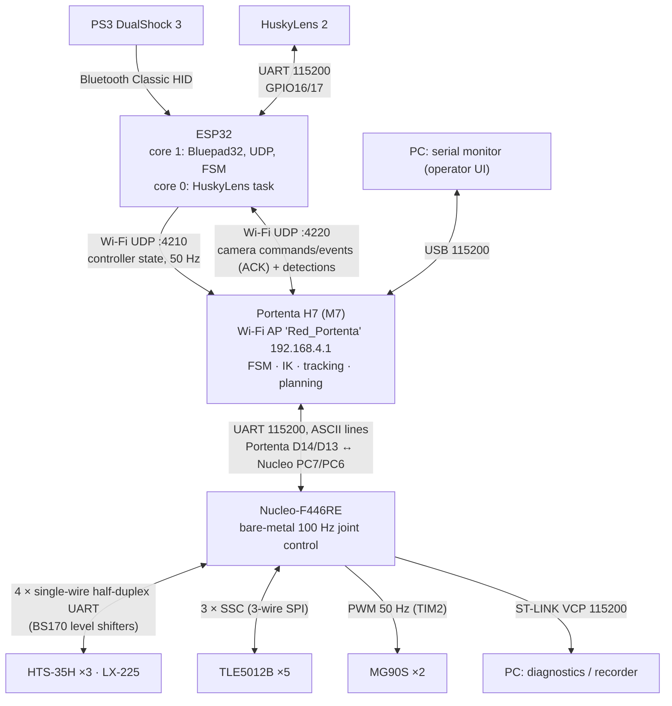
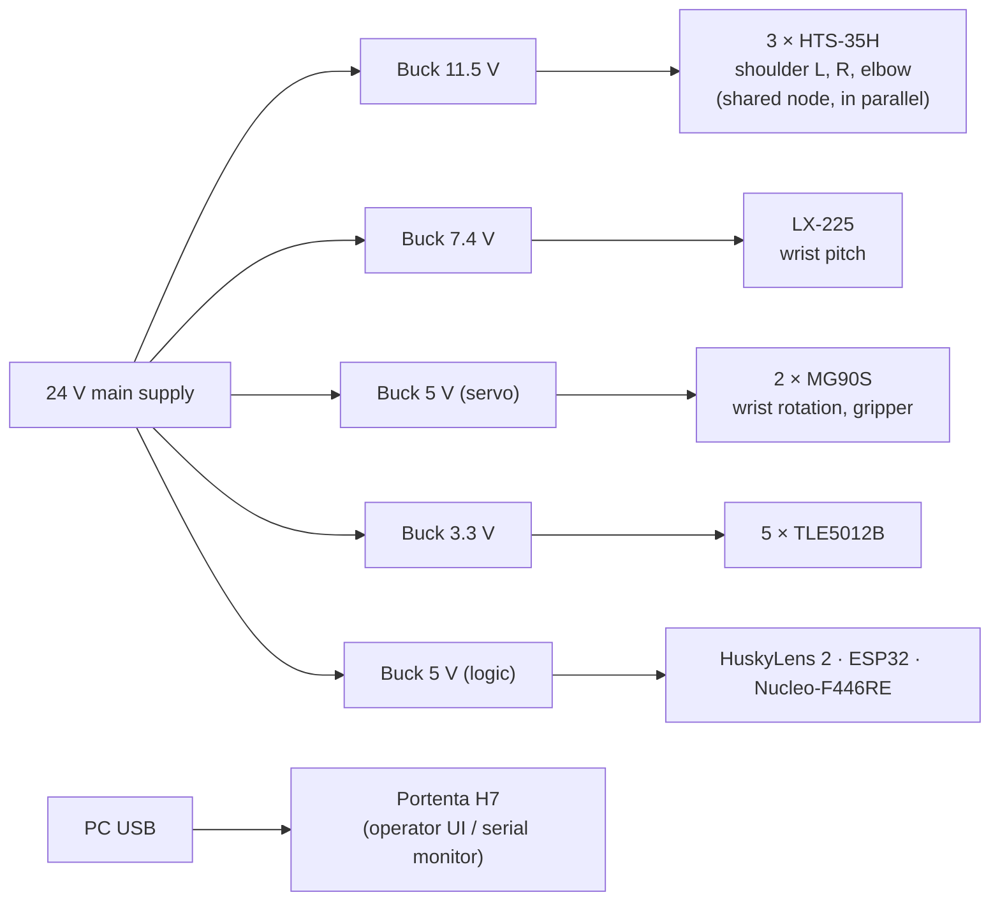
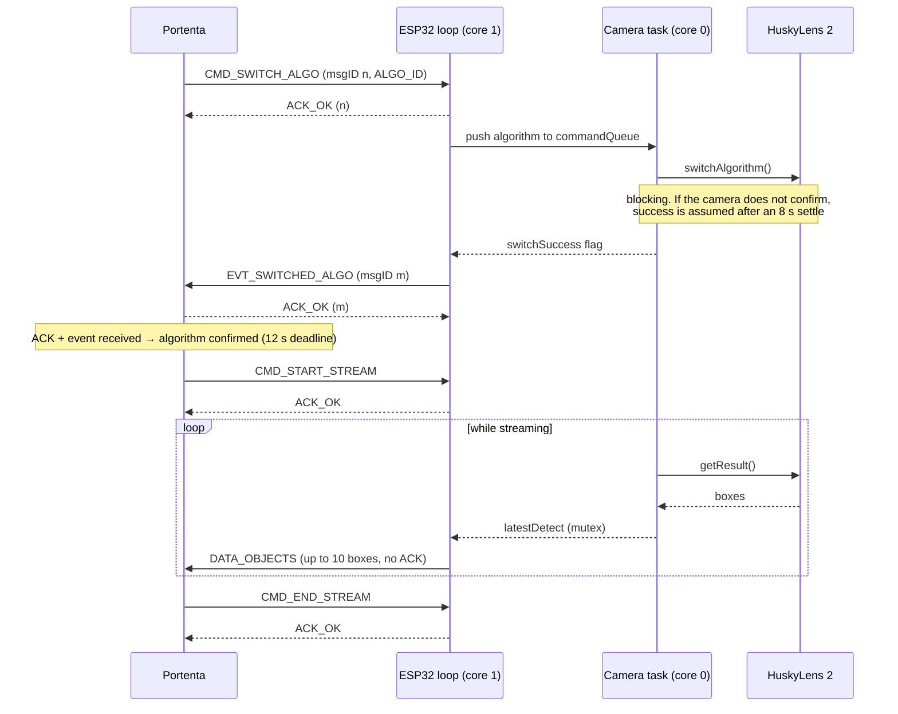
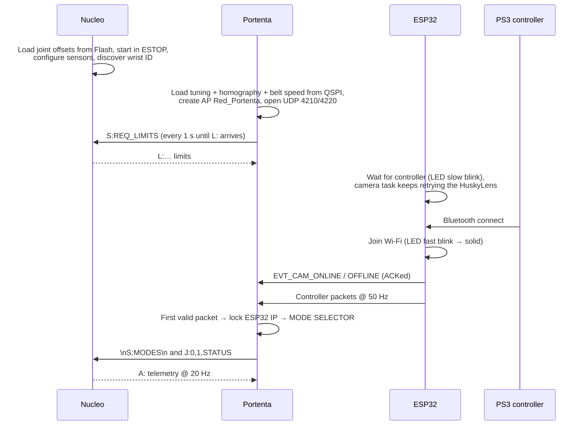
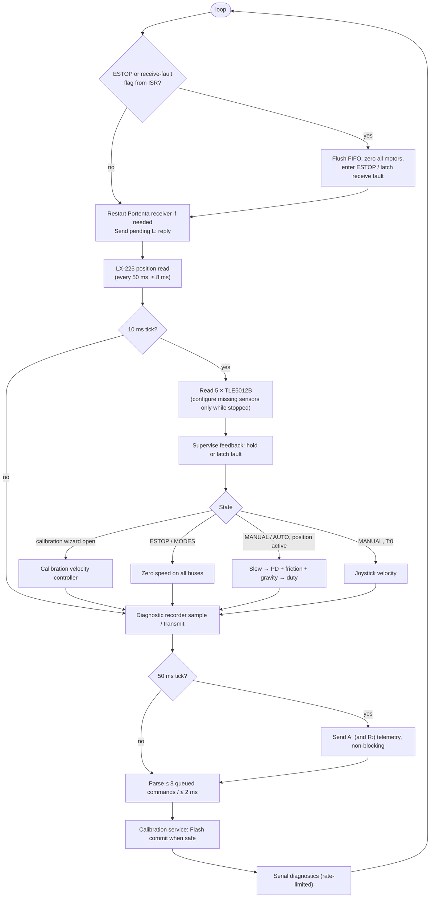
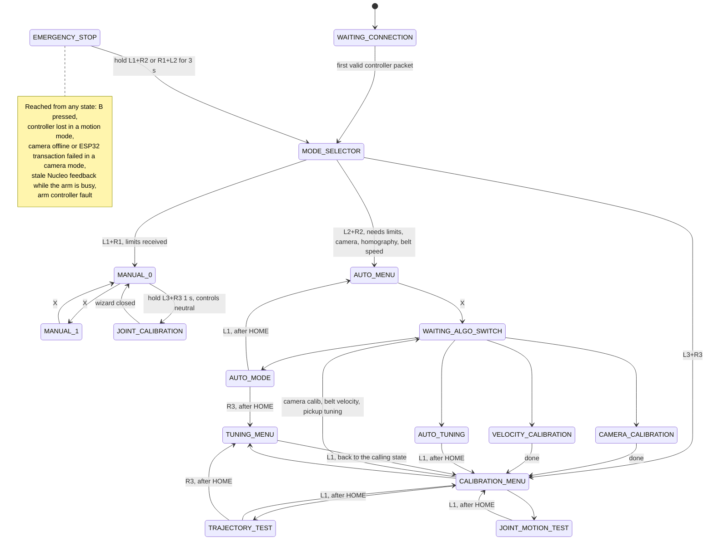
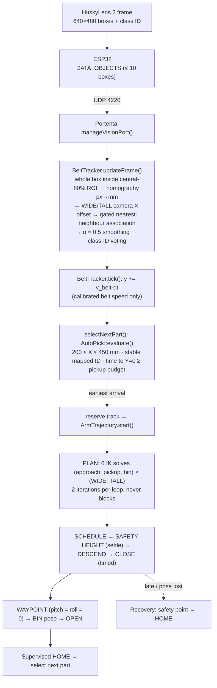
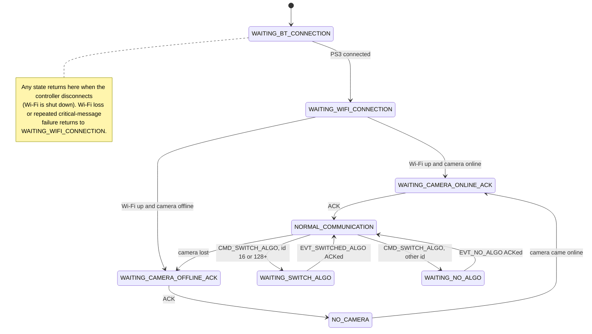

# 5-DOF Vision-Guided Conveyor Sorting Arm

UVG graduation project. A 5-degree-of-freedom robotic arm with a bevel-gear differential shoulder. It picks parts off a moving conveyor belt and sorts them into bins. A HuskyLens 2 AI camera detects and classifies the parts, and a PS3 controller is the operator interface. Three microcontrollers split the work: an **Arduino Portenta H7** (high-level brain), an **STM32 Nucleo-F446RE** (real-time joint control and all I/O) and an **ESP32** (wireless bridge for the controller and the camera).

| | |
|---|---|
| Degrees of freedom | 5 + gripper |
| Shoulder (DOF 1–2) | Bevel-gear differential (pitch + roll), 2 × HiWonder HTS-35H in DC gear-motor mode, 4:1 pulley reduction |
| Elbow (DOF 3) | HTS-35H in gear-motor mode, 4:1 pulley reduction |
| Wrist | DOF 4: HiWonder LX-225 bus servo (servo mode). DOF 5: MG90S PWM servo |
| Gripper | MG90S PWM servo |
| Joint sensing | 5 × Infineon TLE5012B magnetic angle sensors (15-bit, CRC-checked SSC), plus LX-225 internal position |
| Joint control | 100 Hz closed-loop PD with friction and gravity feed-forward, on the Nucleo |
| Operator interface | PS3 DualShock 3 over Bluetooth Classic (Bluepad32), plus the Portenta USB serial monitor |
| Vision | DFRobot HuskyLens 2: AprilTag 36h11 for calibration, custom-trained models for classification |
| Measured (21/10/2026) | 43 % end-to-end sorting success at 119.6 mm/s belt speed; HOME repeatability ≤ 0.52° (sensor-measured) |

> **Final firmware:** Portenta → `firmware/Portenta_Core_V3`, ESP32 → `firmware/ESP32_V3`, Nucleo → `firmware/Nucleo_CodeV2`. The rest of the repository holds the patched camera library, the PC tool for the joint motion test, the MATLAB scripts and the vision training pipeline (see [§2](#2-repository-layout)).

---

## Table of contents

1. [What the system does](#1-what-the-system-does)
2. [Repository layout](#2-repository-layout)
3. [Mechanical and kinematic design](#3-mechanical-and-kinematic-design)
   - [Forward kinematics and the TCP](#36-forward-kinematics-fk)
   - [Geometric Jacobian](#37-jacobian-calculation)
   - [Pose error](#38-how-pose-error-is-calculated)
   - [The pose-dependent blind rotation](#39-how-the-blind-rotation-is-handled)
   - [IK tasks and numerical solver](#310-the-four-ik-tasks)
   - [Which constraints each mode uses](#312-which-kinematic-constraints-each-mode-actually-uses)
4. [System architecture and design rationale](#4-system-architecture-and-design-rationale)
5. [Electronics and wiring](#5-electronics-and-wiring)
6. [Communication protocols](#6-communication-protocols)
7. [Embedded system flow](#7-embedded-system-flow)
8. [Building and flashing the firmware](#8-building-and-flashing-the-firmware)
9. [Operating the robot](#9-operating-the-robot)
10. [Diagnostics and troubleshooting](#10-diagnostics-and-troubleshooting)
11. [Performance and validation results](#11-performance-and-validation-results)
12. [Strengths](#12-strengths)
13. [Weaknesses and limitations](#13-weaknesses-and-limitations)
14. [Suggested improvements](#14-suggested-improvements)
15. [Safety notice](#15-safety-notice)
16. [Further reading](#16-further-reading)

---

## 1. What the system does

The arm stands beside a conveyor belt that carries parts toward the robot (along the robot's **−Y** axis). The camera watches an upstream section of the belt. The Portenta turns each detection into robot coordinates, tracks every part as it moves, predicts when it will cross the robot's pickup line (**Y = 0**) and schedules a pick so the gripper closes exactly as the part arrives. The part is then carried to one of three bins according to its class.

Operating modes, all driven from the PS3 controller:

| Mode | What it does |
|---|---|
| **MANUAL 0** (joint jog) | Each stick or button pair drives one actuator directly. Used for recovery, inspection and joint calibration. |
| **MANUAL 1** (Cartesian jog) | The sticks move the tool centre point (TCP) in X/Y/Z/roll/pitch/yaw. The Portenta solves inverse kinematics (IK) for every increment. |
| **AUTO** | Camera-driven pick-and-sort. Options: *ID ignorant* (everything goes to one bin) or *ID classification*, camera model 131 or 129, and *move arm* or *only vision* (tracking only, no motion). |
| **CALIBRATION MENU** | Camera homography, belt velocity estimation, camera-free trajectory test, joint repeatability test, tuning and storage, live pickup tuning. |
| **Joint calibration wizard** | Guided procedure that teaches the joint zero offsets and stores them in Nucleo Flash. |

### 1.1 Project requirements and how they shaped the architecture

The three-MCU layout follows from mandatory project requirements. It was not an arbitrary choice:

| Requirement / constraint | Consequence in the design |
|---|---|
| The **Portenta H7** had to be used | It is the high-level brain. Without its breakout board it lacks the pins for 4 servo UARTs, 3 SPI buses and PWM, so a **Nucleo-F446RE** was added to own all actuators and sensors. |
| A **PS3 controller** had to be the main interface | The DualShock 3 uses Bluetooth **Classic** HID. The Portenta's Arduino core only exposes BLE, so an **ESP32** (Classic BT + Wi-Fi) runs Bluepad32 and relays the controller. |
| The Portenta's only free hardware UART goes to the Nucleo | The ESP32 cannot use a UART to reach the Portenta. They talk over **Wi-Fi UDP**: the Portenta hosts the access point and the ESP32 joins it. |
| A **HuskyLens 2** had to classify and locate parts on the belt | The camera speaks UART or I²C. It is mounted far from the Portenta, so I²C over that distance is unreliable (bus capacitance), and the Portenta has no spare UART. The camera therefore connects to the **ESP32's second UART**, and a **second UDP port** with acknowledgements carries camera traffic. |
| The HuskyLens 2 library blocks for long periods | The ESP32 runs the camera on its **second core** (FreeRTOS task) so that controller relaying never stalls. |

---

## 2. Repository layout

```
5DOF-Vision-Sorting-Arm/
├── firmware/                        ← FINAL firmware for the three microcontrollers
│   ├── Portenta_Core_V3/            Portenta H7 (M7) sketch: FSM, IK, tracking, planning
│   │   ├── tests/trajectory/        Emulator test harness (Unicorn) for trajectory/IK/AUTO logic
│   │   ├── tests/udp/               Emulator tests for the UDP receive path
│   │   └── *.md                     Deep-dive notes (partly outdated, see below)
│   ├── ESP32_V3/                    ESP32 sketch: Bluepad32 bridge + HuskyLens task
│   └── Nucleo_CodeV2/               Nucleo-F446RE STM32CubeIDE project
│       ├── Core/Src/main.c          Control loop, protocol, drivers
│       ├── Core/Inc/*.h             Feedback, calibration, storage, diagnostics modules
│       ├── Tests/run_tests.py       Emulator tests of the real firmware functions
│       └── ELBOW_SSC.md, FEEDBACK_FIX.md   Design notes
├── libraries/DFRobot_HuskylensV2/   HuskyLens 2 Arduino library 1.0.9 with the local patch (§8.4)
├── tools/joint_motion_report.py     PC recorder/analyser for the joint motion test
├── matlab/                          Thesis scripts: blind rotation axis and IK comparison
└── vision_training/                 YOLO11n-seg training pipeline, delivered model and result figures
    ├── README_ModelTraining.md      How the model was labelled, trained, exported and evaluated
    ├── YOLO11n_seg_pipeline/        Pipeline scripts and configuration, DFRobot_Ready/ holds the model installed on the camera
    └── Training_Results/            Result figures and tables, and the script that generates them
```

The firmware folders keep the version suffixes used during development (`V2` for the Nucleo, `V3` for the Portenta and the ESP32), and each Arduino sketch folder must keep the name of its `.ino` file. All three are the final versions. The MATLAB scripts need Peter Corke's Robotics Toolbox (`SerialLink`). Earlier firmware versions, datasheets and manuals, the raw training data (video, frames, images and labels) and the recorded test data are not included.

### 2.1 Documentation status

This README describes the code as it is now and supersedes the earlier project notes, which are not included in this repository. The module notes (`AUTO_MODE.md`, `JOINT_CALIBRATION.md`, …) are still worth reading for the reasoning behind specific decisions. However, several of their numbers predate later tuning. Where they differ, **the code wins**. Known differences:

| Item | Older docs say | Current code |
|---|---|---|
| Controller link watchdog | 200 ms | **350 ms** (`TIMEOUT_FAILSAFE_MS`) |
| Classification reference pose | `{-76,300,170,0,14.545,90}` | **`{-76,300,130,0,9.583,90}`** (`ClassificationConfig.h`) |
| Part-ID → bin routes | 2→1, 5→2, 8→3 | **2→1, 6→2, 1→3** |
| Belt-height slope | 0.135678 (≈7.7°) | **0.090678 (≈5.18°)** (`PickGeometryDefaults.h`) |
| Classification stable time | 600 ms | **500 ms** (`CameraTrackingConfig.h`) |
| Arrival settling time | 150 ms | **250 ms** (`AutoConfig::settleMs`) |
| Joint motion test cycles | 10 | **50** (`JointMotionTestConfig.h`) |
| Controller transport (early notes) | broadcast, port 1234, text heartbeat | **unicast to 192.168.4.1:4210**, binary packet, 50 Hz |
| Camera link (early notes, V2 readme) | I²C to Portenta / transparent byte bridge on port 12346 | **UART to ESP32**, structured `VisionPacket` on port **4220** |

---

## 3. Mechanical and kinematic design

### 3.1 Joints and actuators

| DOF | Joint | Actuator (bus) | Drive mode | Feedback | Limits (°) |
|---|---|---|---|---|---|
| 1 | Left bevel input **L** | HTS-35H #1 (USART1) | DC gear-motor, 4:1 pulley | TLE5012B on motor axle **and** joint axle | via pitch/roll |
| 2 | Right bevel input **R** | HTS-35H #2 (USART3) | DC gear-motor, 4:1 pulley | TLE5012B on motor axle **and** joint axle | via pitch/roll |
| – | → **Shoulder pitch** q1 = (R − L)/2 | – | – | derived | −50 … +60 |
| – | → **Shoulder roll** q2 = (R + L)/2 | – | – | derived | −60 … +120 |
| 3 | **Elbow** q3 | HTS-35H #3 (UART4) | DC gear-motor, 4:1 pulley | TLE5012B on joint axle | −70 … +90 |
| 4 | **Wrist pitch** q4 | LX-225 (UART5) | Servo (position) mode; motor mode in MANUAL 0 | Internal potentiometer, read over the bus | −200 … +30 |
| 5 | **Wrist rotation** q5 | MG90S (PWM, PA15) | PWM position | None (telemetry is the commanded angle) | −95 … +84 |
| G | **Gripper** | MG90S (PWM, PA1) | PWM position | None | 0 … 180 (open 0, close 175) |

Limits are defined only on the Nucleo and sent to the Portenta on request (`L:` packet, [§6.2](#62-nucleo--portenta-telemetry)).

### 3.2 The bevel-gear differential shoulder

Two motors drive the two side bevel gears. Turning them in the **same** direction rotates the output about its long axis (**roll**). Turning them in **opposite** directions tilts the output (**pitch**). The firmware works in both coordinate sets:

```
pitch = (R − L) / 2        L = roll − pitch
roll  = (R + L) / 2        R = roll + pitch
```

**Why a differential?** Both motors contribute to *both* axes, so each axis can draw on up to twice the torque of a single motor. Both motors sit at the shoulder instead of further out on the arm, which reduces moving mass and inertia.

**What it costs:** every shoulder motion needs both motors working together and both healthy. Bevel-mesh backlash and friction appear in both axes, and the two sides do not have identical friction (the feed-forward compensation is 175 vs 190 duty units, see [§7.2](#72-nucleo-firmware-firmwarenucleo_codev2)). A rule of thumb for diagnosis: if only **L** changes, pitch and roll change by equal and opposite amounts. If only **R** changes, they change by equal amounts with the same sign.

> In **MANUAL 0** the sticks drive the **L** and **R** motors individually, not pitch and roll. Pure pitch or pure roll needs both sticks, or MANUAL 1.

### 3.3 Why HTS-35H in gear-motor mode, 4:1 pulleys and external sensors

* In servo mode the HTS-35H closes its own position loop on an internal potentiometer, limited to roughly 240°. That loop cannot be tuned, compensated for gravity or made to read the true output angle. In **gear-motor mode** the servo becomes a 35 kg·cm-class gearmotor driven by a signed duty command (−1000 … 1000), and the Nucleo closes the loop itself.
* The **4:1 pulley** multiplies the available torque by about four on the heavily loaded joints (shoulder and elbow) and reduces their speed by the same factor.
* The **joint-axle TLE5012B** measures the real output angle after the pulley and bevel gears, so their backlash and belt compliance sit inside the position loop and are corrected by it. The angle is absolute, so no homing is needed at power-up.
* On the bevel joints, the **motor-axle TLE5012B** supplies the velocity used by the derivative (damping) term. It is collocated with the actuator, which keeps belt stretch and gear backlash out of the damping signal and prevents chattering. The elbow uses its single joint-axle sensor for both terms.

### 3.4 Kinematic model

Denavit–Hartenberg parameters (`DOF5_wServo_Kinematics.cpp`). Joint *i* rotates about axis z<sub>i−1</sub>:

| i | Joint | θ offset | d (mm) | a (mm) | α |
|---|---|---|---|---|---|
| 1 | shoulder pitch | 90° | 0 | 0 | 90° |
| 2 | shoulder roll | 0 | 315.557 | 47.45 | 90° |
| 3 | elbow | 0 | 0 | 307.0 | 180° |
| 4 | wrist pitch | 0 | 0 | 0 | −90° |
| 5 | wrist rotation | 0 | 115.14 | 0 | 180° |

Base → frame 0: `T_B0 = [[0,1,0,−76],[0,0,1,0],[1,0,0,102.465],[0,0,0,1]]`. Tool (TCP) offset: `(0, 0, −49)` mm in the last DH frame, so it rotates with the tool.

**HOME** is all five joints at 0°. At HOME:

* The shoulder centre is at (−76, 0, 102.5) mm.
* The **pitch axis** is parallel to the base **Y** axis, which is also the direction of belt travel.
* The **roll axis** is vertical, so at pitch = 0 the shoulder roll acts as the **waist/azimuth** joint.
* The upper arm rises vertically to Z ≈ 418 mm, and the 307 mm forearm points along +X.
* The gripper points straight down. **TCP = (278.45, 0, 253.88) mm, RPY = (0, 0, 0).**

### 3.5 Coordinates and conventions

| Convention | Value |
|---|---|
| Units | mm and degrees at the application interface; radians in the low-level FK, Jacobian and IK calculations |
| Cartesian pose | `x, y, z, roll, pitch, yaw`, ZYX Euler |
| Joint arrays and `A:` telemetry | `pitch, roll, q3, q4, q5` |
| `P:` command | **`roll, pitch, q3, q4, q5`** (historical quirk: roll first) |
| Conveyor | Parts move toward **−Y**. They are picked on the line **Y = 0**. |
| Pickup X range | 200 … 450 mm (`PickMotion::minimumXmm/maximumXmm`) |
| Camera image | 640 × 480 px, homography onto the belt plane |

**Belt contact fit.** The fitted contact height is `Z(X) = −40.104 + adjustment + 0.090678·(X − 300)` mm. Its slope corresponds to about 5.18°, which the pickup orientation uses as an empirical tilt correction. This fit describes the reported TCP coordinates at belt contact; it can absorb robot geometry, sensor-zero and fixture errors, so it does **not** establish that the physical conveyor itself is tilted by 5.18°.

**Bins.** The bins lie on a ring of radius 300 mm around the roll axis at Z = 130 mm. Bins 1, 2 and 3 sit at roll offsets −40°, −20° and 0° from the reference (yaw 50°, 70°, 90°). That puts them at about (116.8, 229.8), (26.6, 281.9) and (−76.0, 300.0) mm. When placing a part, shoulder pitch is held at 0° and shoulder roll at the bin's angle; q3/q4/q5 solve the final pose (see `CLASSIFICATION_WORKSPACE.md` for the reachable arc).

### 3.6 Forward kinematics (FK)

The implementation is in [DOF5_wServo_Kinematics.cpp](firmware/Portenta_Core_V3/DOF5_wServo_Kinematics.cpp), with its types and interfaces in [DOF5_wServo_Kinematics.h](firmware/Portenta_Core_V3/DOF5_wServo_Kinematics.h). **FK answers: given the five calibrated joint angles, where is the TCP and how is its frame oriented?** It is used both to predict a command's pose and to reconstruct the pose reported as `[REAL TCP]` from Nucleo feedback.

The kinematic joint vector is:

$$
q = [q_1,q_2,q_3,q_4,q_5]^T
  = [\text{shoulder pitch},\text{shoulder roll},\text{elbow},\text{wrist pitch},\text{wrist rotation}]^T.
$$

It contains shoulder **pitch and roll**, rather than the two individual bevel input angles L and R. The Nucleo converts between those coordinates using [§3.2](#32-the-bevel-gear-differential-shoulder). The pulley reduction and sensor zero offsets belong to the hardware/feedback layer; the Portenta must not apply the 4:1 reduction to these calibrated joint angles a second time. The fixed DH `theta_offset` values describe the frame convention, whereas Nucleo calibration offsets establish the physical joint zeros. They serve different purposes.

#### Standard DH chain

All five joints are revolute. The firmware uses **standard Denavit–Hartenberg transforms**, in the order `Rz(θ) · Tz(d) · Tx(a) · Rx(α)`, with the parameters in [§3.4](#34-kinematic-model). For joint i:

$$
\theta_i=q_i+\theta_{\mathrm{offset},i},\qquad
A_i =
\begin{bmatrix}
\cos\theta_i & -\sin\theta_i\cos\alpha_i & \sin\theta_i\sin\alpha_i & a_i\cos\theta_i\\
\sin\theta_i & \cos\theta_i\cos\alpha_i & -\cos\theta_i\sin\alpha_i & a_i\sin\theta_i\\
0 & \sin\alpha_i & \cos\alpha_i & d_i\\
0 & 0 & 0 & 1
\end{bmatrix}.
$$

`robot_fkine_all()` multiplies these matrices and retains every accumulated DH frame:

$$
{}^0T_i=A_1A_2\cdots A_i,\qquad
{}^BT_5={}^BT_0\,{}^0T_5.
$$

Here **B** is the robot base/reference frame, and **0** is the initial DH frame. In the code, `T_acc[0]` contains `A1`, and `T_acc[4]` contains `A1·A2·A3·A4·A5`. Those arrays remain expressed in frame 0; `T_B0` is applied when producing the base-frame result. Confusing these two frames would rotate both the position and the joint axes incorrectly.

#### Final DH origin versus claw TCP

The final DH origin is not the pickup/contact point. The tool translation is `toolOffset = (0,0,−49)` mm **in the final DH frame's local axes**. No additional tool-frame rotation is configured:

$$
{}^BT_{TCP}={}^BT_5
\begin{bmatrix}I&t_{tool}\\0&1\end{bmatrix},\qquad
p_{TCP}=p_5+R_5t_{tool},\qquad R_{TCP}=R_5.
$$

Consequently, changing wrist orientation can also move the TCP even when the final DH origin stays fixed. Subtracting 49 mm from base Z is correct only at orientations where the local tool Z points along base Z. Both FK **and the Jacobian** include this offset; otherwise IK could converge on the wrong point.

`robot_fkine_all(q, ...)` accepts radians and returns the transform plus the DH frames. The application wrapper `robot_fkine(q, ...)` accepts **degrees**, converts them internally and returns `[X,Y,Z,roll,pitch,yaw]` in mm/degrees. Application targets, including pickup and classification poses, describe the **TCP**.

#### Orientation convention

The pose-to-matrix conversion uses **ZYX Euler angles**:

$$
R=R_z(\psi)R_y(\vartheta)R_x(\phi),
$$

where φ is TCP roll, ϑ is TCP pitch and ψ is TCP yaw. These are tool-frame pose coordinates, not the shoulder joint angles q1 and q2. FK normally extracts them as:

$$
\vartheta=\operatorname{atan2}(-R_{20},\sqrt{R_{00}^2+R_{10}^2}),\qquad
\phi=\operatorname{atan2}(R_{21},R_{22}),\qquad
\psi=\operatorname{atan2}(R_{10},R_{00}).
$$

At Euler gimbal lock, the extractor uses a separate branch and sets yaw to zero to choose one representation. The rotation matrix is still defined, but roll and yaw are not independently identifiable there. Comparing raw Euler values across a wrap or singularity can therefore suggest an orientation jump that is not a physical jump.

### 3.7 Jacobian calculation

`robot_jacobian()` calculates an **analytic geometric Jacobian using the revolute-joint axis/cross-product construction**. It is evaluated directly from the accumulated DH transforms; runtime calculations do not use numerical finite differences, symbolic differentiation, or a cross product chosen to guess the missing rotation.

The result is a 6 × 5 matrix, expressed in the **base frame**:

$$
\begin{bmatrix}\dot p_{TCP}\\\omega_{TCP}\end{bmatrix}
=J(q)\dot q,\qquad
J=\begin{bmatrix}J_v\\J_\omega\end{bmatrix},
\qquad J_v,J_\omega\in\mathbb{R}^{3\times5}.
$$

The upper three rows map joint rates to TCP linear velocity; the lower three map them to the TCP's **angular-velocity vector**. These lower rows are not roll/pitch/yaw derivatives. With joint rates in rad/s, the outputs are mm/s and rad/s respectively.

For each revolute joint i, let `z(i−1)` be its rotation axis and `o(i−1)` a point on that axis, both expressed in DH frame 0. The first axis is `(0,0,1)` through the origin; subsequent axes and origins come from the preceding accumulated transform. First calculate the TCP location in that same frame, including the tool translation. Then:

$$
{}^0J_{v,i}={}^0z_{i-1}\times({}^0p_{TCP}-{}^0o_{i-1}),\qquad
{}^0J_{\omega,i}={}^0z_{i-1}.
$$

Finally rotate both blocks into the base frame using the rotation block of `T_B0`:

$$
{}^BJ_{v,i}={}^BR_0\,{}^0J_{v,i},\qquad
{}^BJ_{\omega,i}={}^BR_0\,{}^0J_{\omega,i}.
$$

The base translation is already accounted for by the relative position in the cross product; it is not added to a velocity column. This is the Jacobian of the **TCP point's velocity**, with all quantities expressed consistently in B.

The Jacobian is recomputed at every IK iterate because its axes, moment arms, rank and attainable motions depend on the pose. A 6 × 5 Jacobian has rank at most five: six independently specified pose coordinates generally cannot all be controlled. Even XYZ reachability depends on workspace, joint limits, joint locks and singularities; five joints do not guarantee every XYZ point is reachable.

### 3.8 How pose error is calculated

`error_vector()` computes the complete six-component error before any task-specific relaxation:

$$
e=\begin{bmatrix}e_p\\e_\omega\end{bmatrix},\qquad
e_p=p_d-p_a,\qquad
R_e=R_dR_a^T,\qquad
e_\omega=\operatorname{Log}(R_e)^\vee.
$$

Subscripts d and a mean desired and actual **model** poses. The translation error is in mm. The orientation error is an axis-angle vector in radians, expressed in the base frame, matching the angular rows of the geometric Jacobian. Its magnitude is the rotation angle needed to align the frames. It is not the componentwise subtraction of three Euler angles.

The implementation calculates `θ = acos(clamp((trace(Re)−1)/2, −1, 1))`. In the ordinary case:

$$
e_\omega=\frac{\theta}{2\sin\theta}
\begin{bmatrix}(R_e)_{21}-(R_e)_{12}\\(R_e)_{02}-(R_e)_{20}\\(R_e)_{10}-(R_e)_{01}\end{bmatrix}.
$$

Separate small-angle and near-180° branches avoid division by very small `sin(θ)`. The near-180° branch reconstructs the axis from the largest diagonal element. This matters for large wrist reorientations, where a simple skew-matrix error alone can incorrectly approach zero.

The Jacobian parameter remains in the `error_vector()` signature for interface compatibility, but the function itself **does not project out a blind axis**. Task selection and projection happen in `IkStepper::step()`. Keeping the complete error available is what lets diagnostics report both the controlled residual and the orientation mismatch that was deliberately relaxed.

### 3.9 How the blind rotation is handled

**The unavailable rotation is pose dependent. It is not permanently TCP roll, pitch or yaw.** The current implementation handles it in `PositionClosestOrientation`, using the private `orientationProjector()` function. The construction asks a precise question: *which instantaneous tool rotations can the joints generate while holding the TCP position?*

#### Hold position first when identifying the available rotations

A joint displacement that leaves TCP position unchanged to first order satisfies:

$$
J_v\,\delta q=0.
$$

Let N contain an orthonormal basis of `null(Jv)`. Every such displacement can be written `δq = Nη`. Its angular effect is:

$$
\delta\omega=J_\omega N\eta,\qquad W=J_\omega N.
$$

Thus the **column space of W** is the attainable angular-velocity subspace with TCP position held. At a regular pose with five free joints, `rank(Jv)=3`, leaving two joint freedoms. Usually W has rank two: two independent rotations are available, and one angular direction is blind. At singular configurations or with fixed joints, the ranks can differ, so the implementation does not assume there is always exactly one blind direction.

`orientationProjector()` implements this with **two-pass Gram–Schmidt orthogonalisation**, using double-precision working arrays:

1. Orthonormalise the three rows of Jv to obtain a basis of its row space.
2. Project the five joint-coordinate unit vectors away from that row space and from previously accepted null vectors. The survivors form N.
3. Map each null vector through Jω to obtain the columns of W.
4. Orthonormalise those angular vectors to obtain U, a basis of `range(W)`.
5. Form the 3 × 3 projector `Pω = U·Uᵀ`.

This is a basis construction, not an SVD. Row-space acceptance uses a norm threshold `max(10⁻⁶, originalRowNorm·10⁻⁶)`; null vectors use `10⁻⁶` and angular vectors `10⁻⁵`. These are numerical rank thresholds rather than physical angle tolerances.

#### Project both the orientation error and its Jacobian

For this task, the solver uses:

$$
e_{\omega,c}=P_\omega e_\omega,\qquad
J_{\omega,c}=P_\omega J_\omega.
$$

The unprojected position rows remain in the solve and position acceptance remains mandatory. The discarded angular residual is `(I−Pω)eω`. When exactly one blind unit direction b exists, this reduces to the familiar formula:

$$
P_\omega=I-bb^T,\qquad
e_{\omega,c}=e_\omega-b(b^Te_\omega).
$$

**This is how the current firmware makes up for the missing rotational freedom.** It relaxes the angular residual outside the attainable subspace; it does not invent a sixth joint or accept an arbitrary XYZ error. Projecting the angular Jacobian as well as the angular error makes the local task consistent. The projector is rebuilt at every iteration, after applying any fixed-joint mask, so the relaxed direction follows the pose and the joints actually allowed to move.

#### Relationship to the earlier `null(Jᵀ)` approach

For a regular rank-five 6 × 5 Jacobian, a full left-null vector can be written as `n = [a; b]`, where:

$$
J^Tn=J_v^Ta+J_\omega^Tb=0.
$$

Premultiplying by `Nᵀ` eliminates the translational term:

$$
(J_\omega N)^Tb=W^Tb=0.
$$

Therefore, with those rank assumptions, the **last three components of a correctly computed full left-null vector do identify the same blind angular direction**, after normalisation. The original idea of a pose-dependent blind axis is valid. Its six components together describe a constraint on a mixed linear/angular motion space; the first and last three components must not simply be treated as one physical rotation axis.

The present code obtains the angular subspace directly through `Jω·null(Jv)`. This explicitly defines that TCP position is held, incorporates the rotated tool offset, handles multiple unavailable angular directions and avoids deriving an axis from an arbitrary cross product. It also avoids the numerical conditioning of orthogonalising a full matrix whose upper and lower blocks have different units. There is no SVD of the full `Jᵀ` in the current implementation.

#### What this compensation cannot promise

The construction is **local**, based on first-order motion at the current pose. `PositionClosestOrientation` is the task's code name; it does not guarantee a globally nearest orientation, a globally optimal IK branch, or a collision-free path. The numerical step is a scaled least-squares compromise, not a strict hierarchical position-first null-space controller. Final acceptance nevertheless requires XYZ error within tolerance. Joint bounds are enforced by clamping the next iterate, rather than by a full constrained optimisation, so a geometrically available direction may still be blocked by a limit.

An intentionally relaxed rotation may remain large even when this task reports success. That is acceptable for a manual jog that permits orientation relaxation, but it must not be used where the jaw heading or tool tilt is mandatory. Those targets use another task, described next.

### 3.10 The four IK tasks

The same FK and TCP geometric Jacobian support four different task definitions:

| `IkTask` | Residual and Jacobian rows used | Acceptance for rotation | Meaning |
|---|---|---|---|
| `FullPose` | XYZ plus the complete axis-angle error and Jω | `‖eω‖ ≤ rotTolerance` | Preserve all requested orientation components. A compatible six-coordinate pose may be reached; an incompatible one must fail. |
| `PositionPitchYaw` | XYZ plus wrapped Euler pitch/yaw differences and their rate Jacobian | `max(abs(pitchError), abs(yawError)) ≤ rotTolerance` | Explicitly leave TCP roll free while requiring pitch and yaw. This chooses a particular reduced task rather than calculating a blind axis. |
| `PositionClosestOrientation` | XYZ plus `Pω·eω` and `Pω·Jω` | `‖Pω·eω‖ ≤ rotTolerance` | Relax pose-dependent unavailable rotation while keeping XYZ within tolerance. |
| `PositionOnly` | XYZ and Jv only | No orientation requirement; controlled rotation error is zero | Reach a point without constraining the tool orientation. Joint locks can still restrict reachability. |

All tasks require `‖ep‖ ≤ posTolerance`. A nominally overdetermined `FullPose` request is not automatically impossible: a target generated by FK is on the robot's reachable pose set, and some application poses are deliberately chosen on that set. The problem is specifying six **independent** coordinates that disagree with it.

For `PositionPitchYaw`, a geometric angular-velocity Jacobian cannot be used as if its rows were Euler-angle rates. At the current TCP pitch ϑ and yaw ψ, the code constructs the correct ZYX rate rows:

$$
J_{pitch}=-\sin\psi\,J_{\omega x}+\cos\psi\,J_{\omega y},
$$

$$
J_{yaw}=\tan\vartheta(\cos\psi\,J_{\omega x}+\sin\psi\,J_{\omega y})+J_{\omega z}.
$$

Pitch and yaw errors are wrapped with `atan2(sin(error),cos(error))`. This reduced Euler task rejects desired pitch at or beyond ±89° and detects near-gimbal-lock iterates. Its initialisation can perturb a free shoulder-pitch seed by 2° when the starting Euler representation is singular. The matrix/axis-angle tasks do not use these Euler rate rows.

### 3.11 Numerical IK: damped least squares, limits and acceptance

**IK answers: which calibrated joint angles produce the requested TCP task?** There is no closed-form analytic inverse in this firmware. `IkStepper` repeatedly evaluates FK, pose error and the geometric Jacobian, then solves a damped least-squares update from a seed. A nearby seed helps it remain on a continuous solution branch, but does not guarantee convergence.

#### Scaling and linear solve

To balance position in mm against orientation in radians, the code divides **both** the position error and the position Jacobian by 50. For the projected-orientation task, for example:

$$
\widetilde e=\begin{bmatrix}e_p/50\\P_\omega e_\omega\end{bmatrix},\qquad
\widetilde J=\begin{bmatrix}J_v/50\\P_\omega J_\omega\end{bmatrix}.
$$

The other tasks substitute their corresponding angular rows, or omit them. The update is found from:

$$
(\widetilde J^T\widetilde J+10^{-4}I)\,\delta q
=\widetilde J^T\widetilde e.
$$

This is **damped least squares (DLS)**. Damping prevents the step from exploding when the task Jacobian is singular or nearly singular. The implementation solves this 5 × 5 system with Gaussian elimination and partial pivoting, using double-precision working arrays; it does not form a matrix inverse or compute an SVD pseudoinverse.

The literal diagonal regularisation is `0.0001`. In the common notation `JᵀJ + λ²I`, that means **λ = 0.01**, not λ = 0.0001. There is no adaptive damping or line search. Scaling affects the least-squares compromise, whereas final acceptance still uses unscaled mm and radians.

#### Step size, joint bounds and locked joints

Let `m = max(abs(δqi))`. The update gain is `g = 0.7` if `m ≤ 0.12`, otherwise `g = 0.7·0.12/m`. Each free joint is updated by:

$$
q_i^{next}=\operatorname{clamp}(q_i+g\,\delta q_i,q_{min,i},q_{max,i}).
$$

The largest actual update is therefore at most **0.084 rad, about 4.81°**, before joint-limit clamping. This is a bound on a **numerical IK iteration**; it is not a commanded velocity or a physical motion step. Only the finished joint target is sent to the Nucleo.

`fixedJointMask` bits 0–4 correspond to `[pitch,roll,q3,q4,q5]`. Locked joints retain their seed values and their Jacobian columns are zeroed before task/projection construction. Invalid locked seeds are rejected; unlocked seeds are initially clamped into the allowed range. For example, `0x03` locks both shoulder coordinates. Locking a joint can create further unavailable motions; the solver does not silently release it to obtain a solution.

#### Success and failure

AUTO currently allows **150 iterations per target**, with **0.5 mm** position tolerance and **0.035 rad** rotation tolerance (about 2.01° for tasks using an angle norm). MANUAL 1 uses **250 iterations** with the same tolerances. Before accepting a solution, the solver rounds every joint to the actual **0.01° command precision**, recomputes FK and task error, and checks all limits again. If rounding invalidates an otherwise acceptable solution, it continues refining while the iteration budget remains.

`IkReport` contains the state, task, failure reason, iteration count and three distinct residuals:

| Field | Meaning |
|---|---|
| `positionErrorMm` | Euclidean TCP position error, in mm |
| `controlledRotationErrorRad` | The task's angular acceptance metric: full angle, projected angle, maximum pitch/yaw error, or zero for XYZ-only |
| `fullRotationErrorRad` | Complete unprojected axis-angle mismatch, even when the task relaxes orientation |

Failure reasons are `InvalidInput`, `EulerSingularity`, `IterationLimit` and `LinearSolve`. An iteration-limit failure can mean an incompatible target, a bad seed, a singular pose or a joint-limit obstruction; it is not proof that more iterations will fix the problem.

`ArmTrajectory` calls `IkStepper::step(2)` so AUTO/trajectory planning performs at most two IK iterations per service call and yields to communication and supervision between calls. The `robot_ikine()` convenience wrapper instead runs a solve **synchronously** by repeatedly calling `step(1)` until completion; MANUAL 1 reaches it through `robot_ikine_increment()`. Thus planning is incremental in AUTO, while a manual increment can occupy the application loop for a complete solve.

### 3.12 Which kinematic constraints each mode actually uses

The existence of a task in the solver does not mean every mode selects it. The call sites in [Portenta_Core_V3.ino](firmware/Portenta_Core_V3/Portenta_Core_V3.ino), [ArmTrajectory.cpp](firmware/Portenta_Core_V3/ArmTrajectory.cpp), [PickMotionConfig.h](firmware/Portenta_Core_V3/PickMotionConfig.h) and [ClassificationConfig.h](firmware/Portenta_Core_V3/ClassificationConfig.h) determine the current behaviour:

| Movement | Current task / construction | Why |
|---|---|---|
| MANUAL 1 increment | `PositionClosestOrientation`, seeded from the previous accepted command | Keep requested XYZ within tolerance while relaxing the rotation unavailable at the current pose. |
| Shared AUTO / trajectory-test safety height | `FullPose` | The tested approach tilt and jaw heading are explicit requirements. |
| Shared AUTO / trajectory-test gripping height | `FullPose`, separately planned for WIDE/TALL box profiles | Preserve the tested tilt and the final 0°/90° jaw heading. Incompatibility rejects the plan rather than silently rotating the jaws. |
| Classification waypoint | Direct joint target: shoulder pitch/roll zero; q3/q4 from measured pickup feedback and q5 from the pickup command | Preserve the distal configuration while bringing the shoulder to its transport waypoint. This waypoint is not an IK solve. |
| Current classification pose | `FullPose`, mask `0x03`: shoulder pitch 0°, shoulder roll calculated for the selected bin | The ring and orientation were chosen to be compatible with the remaining q3/q4/q5 motion. Both shoulder locks and full-pose acceptance are enforced. |
| HOME | Direct joint target `[0,0,0,0,0]` | HOME is defined by calibrated joint zeros, with FK used to evaluate its TCP. It does not require IK. |

In the current configuration, `Classification::configure()` sets `classificationFixedShoulders=true` and `holdPickupQ5ForSorting=false`. Therefore q5 is allowed to change at the final bin pose to satisfy its orientation. Older discussions about preserving pickup q5 or relaxing classification orientation describe earlier configurations, not this active one.

The planner also supports other configurations: generic sorting uses `PositionClosestOrientation`; setting only `classificationPitchZero` locks shoulder pitch and uses `PositionOnly`; an optional q5 lock pins q5 inside the solve. These alternatives do not override the active fixed-shoulder/full-pose configuration, and combining locks can make a destination unreachable.

For MANUAL 1, `robot_ikine_increment()` builds a candidate pose and commits **both the target and its joint seed only after success**. A failed jog does not accumulate an unreachable target. With orientation relaxation, however, the accepted pose variable still contains the **requested** Euler orientation; it is not overwritten with FK of the achievable orientation. `[IK TCP]` can therefore retain a requested rotation that `[REAL TCP]` cannot reproduce. Check the controlled/full residuals to tell deliberate relaxation from failed joint tracking.

### 3.13 Interpreting FK/IK discrepancies and checking changes

There are three different comparisons:

1. **IK consistency:** FK of the rounded, accepted joint command versus the requested task. This is checked by the solver before a target is sent (0.5 mm / task-specific angular tolerance).
2. **Motion tracking:** FK of measured joint feedback versus FK of the joint command, plus individual joint errors. `ArmTrajectory` supervises these using its larger physical arrival tolerances (normally 5 mm, 1° per joint and 1.5° at q4, with configured hold hysteresis). These are distinct from IK convergence tolerances.
3. **Physical accuracy:** the actual claw contact point versus an independent physical reference. Neither FK of commands nor FK of the same encoder readings can independently validate link dimensions, encoder alignment, physical zero offsets or deformation. q5 is especially limited because its feedback is command-derived.

Large XYZ differences between requested and reported TCP should not be attributed automatically to the blind rotation. Inspect calibrated joint target/actual errors, feedback validity and age, the L/R differential conversion, degree/radian interfaces, tool offset and physical geometry. A motor that fails to follow its target can create simultaneous pitch/roll errors and a diagonal TCP motion even when the IK solution is internally correct. A projected task still has to pass its XYZ check.

For a Jacobian change, the independent numerical check is to perturb one joint by a small **radian** amount and compare the resulting FK position difference with that column of Jv; compare the small base-frame rotation `Log(R(q+εei)·R(q)ᵀ)/ε` with its Jω column. This describes a validation method, not the production Jacobian calculation. Include non-HOME poses and the tool offset. For a projector, check symmetry/idempotence, `Jv·N ≈ 0`, and that the projected angular basis matches `Jω·N`; test singular poses and joint masks as well as regular poses.

Existing [controller/IK regression tests](firmware/Portenta_Core_V3/tests/trajectory/controller_tests.cpp) cover rounded reachable targets, strict versus relaxed orientation, transactional manual increments, repeated Cartesian jogs, invalid fixed-joint seeds and fixed-shoulder classification acceptance/rejection. They test mathematical/software consistency without the robot; they do not establish the arm's physical accuracy or path safety. See [§8.6](#86-host-side-tests-no-hardware-needed) for the runner.

---

## 4. System architecture and design rationale



| MCU | Role | Owns |
|---|---|---|
| **Portenta H7** (M7 core, Mbed OS) | Brain | Operator FSM and menus, Wi-Fi AP, controller-link supervision, emergency latch, forward and inverse kinematics, camera homography, belt tracking, pick scheduling and supervision, runtime tuning and QSPI storage |
| **Nucleo-F446RE** (bare metal, HAL) | Spine and muscle | All actuators and sensors, 100 Hz joint control loop, slew limiting, friction and gravity compensation, sensor validation, joint limits and offsets, joint-calibration Flash journal |
| **ESP32** (Arduino, FreeRTOS) | Wireless bridge | PS3 controller via Bluepad32, Wi-Fi client, controller stream, HuskyLens driver on its own core, camera event and acknowledgement protocol |

The Portenta never talks to motors or sensors and holds **no hardware offsets or limits**. It receives calibrated joint angles and joint limits from the Nucleo, and sends back either **movement directions** (`M:`) or **absolute calibrated joint targets** (`P:`/`G:`). The Nucleo hides how each joint is driven.

### 4.1 Why it is built this way

**Why a separate real-time board (Nucleo).** Apart from the pin count ([§1.1](#11-project-requirements-and-how-they-shaped-the-architecture)), the Nucleo keeps the control loop deterministic. The Portenta runs Mbed OS, the Wi-Fi stack and long IK computations, all of which add timing jitter. The Nucleo's single bare-metal loop holds a 10 ms control period (median 10 ms, p95 10 ms in recorded runs). The F446RE also has six UARTs and three SPI peripherals, which is exactly what this arm needs.

**Why each HiWonder servo has its own UART.** On a shared bus every packet is serialised. At 115 200 baud a 10-byte command takes about 0.87 ms, and each position read adds a request, a reply and two bus turnarounds. With four servos plus reads, a shared bus caps the refresh rate and makes it uneven. With four independent UARTs:

* all four commands go out **in parallel** (interrupt-driven) on every 10 ms tick;
* each bus carries exactly one servo, so the firmware can address speed commands to the **broadcast ID 254** and discover the wrist ID automatically. Duplicate IDs are harmless (the left shoulder servo and the elbow servo both report ID 3);
* a noisy or failed bus affects only one joint and can be diagnosed per bus.

**Why one SPI bus per joint.** Each joint's sensors are electrically isolated from the others: one faulty sensor or connector cannot corrupt another joint's feedback, and every bus can be configured and recovered independently. The elbow bus (SPI3) showed 1-bit-shifted frames in hardware 1-line receive mode, so its clock and data are **bit-banged in GPIO** at ≤ 500 kHz with CRC still required (`ELBOW_SSC.md`). SPI1 and SPI2 run in hardware at 5.25 MHz.

**Why a text protocol between Portenta and Nucleo.** ASCII lines can be read, logged and even typed by hand (for example `P:` from the serial monitor). Parsing is simple and a framing error is self-evident. The cost is bandwidth, which is irrelevant at 20 Hz telemetry.

**Why the Portenta hosts the Wi-Fi network.** The Portenta is always present and owns the system, so it creates the access point (`Red_Portenta`, fixed IP 192.168.4.1). The ESP32 can then send unicast datagrams without any discovery. The ESP32 shares one radio between Bluetooth Classic and Wi-Fi, so keeping it a simple station rather than an access point keeps its Wi-Fi duties light. The early notes describe this as avoiding Bluepad32 BT/Wi-Fi interference.

**Why UDP, and why two ports.** UDP has no connection setup, retransmission stalls or head-of-line blocking. The two kinds of traffic need different handling:

* **Controller (port 4210):** a periodic *state* stream where the latest packet always wins. Losing one is harmless because the next arrives 20 ms later. Each packet carries a sequence number (discards stale or duplicate packets) and a checksum, and a 350 ms watchdog detects link loss. Acknowledgements would only add latency.
* **Camera (port 4220):** algorithm switches, stream start/stop and camera online/offline are *events* that change state on both sides. Losing one would desynchronise the boards, so they use **msgID + ACK + retries**. Detection frames are themselves a stream and are sent without acknowledgement.

**Why the camera runs on the ESP32's second core.** The DFRobot HuskyLens 2 library is synchronous. Every request busy-waits for a reply, with retries, and the stock timeout is 5 s per wait with up to 5 retries. Switching algorithms makes the camera unresponsive for several seconds. If that ran in the Arduino `loop()` it would freeze Bluepad32 polling and the 50 Hz controller stream, which would trip the Portenta's watchdog and cause an emergency stop. The camera therefore runs in its own FreeRTOS task **pinned to core 0**, exchanging data with core 1 through a mutex-protected frame buffer and a one-slot command queue. The installed library is also patched to shorten its timeouts ([§8.4](#84-esp32-firmwareesp32_v3)).

---

## 5. Electronics and wiring

### 5.1 Power distribution



| Rail | Source | Loads | Notes |
|---|---|---|---|
| 24 V | Main PSU | Five buck converters | Best place for a hardware emergency stop (see [§15](#15-safety-notice)) |
| 11.5 V | Buck 1 | HTS-35H × 3 | HTS-35H nominal 11.1 V (9–12.6 V). All three share one power node |
| 7.4 V | Buck 2 | LX-225 | Nominal 7.4 V (6–7.4 V) |
| 5 V servo | Buck 3 | MG90S × 2 | Kept separate so servo current spikes do not disturb logic |
| 3.3 V | Buck 4 | TLE5012B × 5 | Quiet dedicated rail at the Nucleo's logic level |
| 5 V logic | Buck 5 | HuskyLens 2, ESP32, Nucleo | Also the 5 V side of the BS170 level shifters |
| USB | PC | Portenta H7 | The Portenta stays on the PC because its serial monitor is the main text UI |

**All grounds are common.** The UART and SSC links need a shared reference.

**Why separate rails:** each actuator family runs at its rated voltage, and a stalling motor cannot brown out a microcontroller. Because the sensors have their own rail, they can be powered before or after the Nucleo. The firmware handles this: sensors are configured and verified *while stopped*, whenever they appear ([§7.2](#72-nucleo-firmware-firmwarenucleo_codev2)).

### 5.2 Nucleo-F446RE pin map

System clock: HSI 16 MHz → PLL → **84 MHz** (APB1 42 MHz, APB2 84 MHz). Arduino-header names follow the Nucleo-64 user manual (UM1724); pins without one are on the Morpho headers.

| Function | MCU pin | Header | Peripheral / mode | Connects to |
|---|---|---|---|---|
| Shoulder **L** motor bus | PA9 | D8 | USART1_TX, single-wire half-duplex, 115 200 | BS170 shifter → HTS-35H #1 SIG |
| Shoulder **R** motor bus | PB10 | D6 | USART3_TX, half-duplex | BS170 → HTS-35H #2 |
| Elbow motor bus | PA0 | A0 | UART4_TX, half-duplex | BS170 → HTS-35H #3 |
| Wrist pitch bus | PC12 | Morpho | UART5_TX, half-duplex | BS170 → LX-225 |
| Portenta link TX | PC6 | Morpho | USART6_TX | Portenta **D13** (RX) |
| Portenta link RX | PC7 | D9 | USART6_RX, DMA2 Stream1 circular + idle-line | Portenta **D14** (TX) |
| PC diagnostics | PA2 / PA3 | D1 / D0 | USART2, 115 200 | ST-LINK virtual COM port (USB) |
| DOF 1 sensors SCK | PA5 | D13 | SPI1_SCK, 5.25 MHz | both DOF 1 TLE5012B |
| DOF 1 sensors DATA | PA7 | D11 | SPI1 1-line bidirectional | both DOF 1 TLE5012B |
| DOF 1 motor-axle CS | PB9 | D14 | GPIO out | TLE5012B CSQ |
| DOF 1 joint-axle CS | PB8 | D15 | GPIO out | TLE5012B CSQ |
| DOF 2 sensors SCK | PB13 | Morpho | SPI2_SCK, 5.25 MHz | both DOF 2 TLE5012B |
| DOF 2 sensors DATA | PC1 | A4 | SPI2 1-line bidirectional | both DOF 2 TLE5012B |
| DOF 2 motor-axle CS | PB7 | Morpho | GPIO out | TLE5012B CSQ |
| DOF 2 joint-axle CS | PB6 | D10 | GPIO out | TLE5012B CSQ |
| Elbow sensor SCK | PC10 | Morpho | **GPIO bit-banged** (SPI3 pins), ≤ 500 kHz | TLE5012B |
| Elbow sensor DATA | PB0 | A3 | **GPIO bidirectional** | TLE5012B |
| Elbow joint-axle CS | PB4 | D5 | GPIO out | TLE5012B CSQ |
| (Elbow motor-axle CS) | PB5 | D4 | GPIO out, reserved | not populated |
| Wrist rotation PWM | PA15 | Morpho | TIM2_CH1, 50 Hz | MG90S (DOF 5) |
| Gripper PWM | PA1 | A1 | TIM2_CH2, 50 Hz | MG90S (gripper) |
| SWD / SWO | PA13 / PA14 / PB3 | – | Debug | ST-LINK |

> PA2/PA3 (D1/D0) are wired to the ST-LINK by default; do not use them for anything else.

### 5.3 Portenta H7 connections

| Portenta | Connects to | Notes |
|---|---|---|
| D14 (Serial1 TX) | Nucleo PC7 (USART6_RX) | 115 200 8N1 |
| D13 (Serial1 RX) | Nucleo PC6 (USART6_TX) | |
| GND | Common ground | Mandatory |
| USB-C | PC | Power plus `Serial` monitor at 115 200 (operator text UI) |
| Onboard Wi-Fi | – | Access point `Red_Portenta`, 192.168.4.1 |

### 5.4 ESP32 connections

| ESP32 | Connects to | Notes |
|---|---|---|
| GPIO16 (RX2) | HuskyLens 2 TX (blue wire) | `Serial2`, 115 200 8N1 |
| GPIO17 (TX2) | HuskyLens 2 RX (green wire) | |
| GPIO2 | Status LED | Slow blink: waiting for the PS3 controller. Fast blink: joining Wi-Fi. Solid: connected |
| 5 V / GND | 5 V logic rail | |

Use an **original ESP32** (for example ESP32-DevKitC). The DualShock 3 needs Bluetooth Classic (BR/EDR), which the ESP32-S2/S3/C3 do not have.

### 5.5 Servo bus level shifting (BS170, one per HiWonder bus)

The Nucleo drives the four servo buses at 3.3 V logic. The servo side is pulled up to 5 V. Each bus has a discrete bidirectional MOSFET translator:

```
          3.3 V                        5 V (logic rail)
            │                            │
          [1 kΩ]                       [1 kΩ]
            │                            │
Nucleo ─────┴──── S ┌─────────┐ D ───────┴────── Servo SIG
(USARTx_TX)         │  BS170  │                  (half-duplex)
                    └────┬────┘
                         G
                         │
                       3.3 V
```

* **Idle:** both sides are pulled high.
* **Nucleo pulls low:** V<sub>GS</sub> rises above threshold, the FET conducts and the servo side goes low.
* **Servo pulls low:** the body diode, then the channel, pull the Nucleo side low.

The 1 kΩ pull-ups give fast edges on long, capacitive servo cables at 115 200 baud.

**Why the firmware switches pin mode on every turnaround.** The servo replies on the same wire. If the MCU kept driving the line push-pull high, the servo could not pull it low through the shifter. The firmware therefore alternates between two states (`ServoBusTransmit` / `ServoBusReceive`; STM32 RM0390 §25.4.10):

| Phase | Pin | USART |
|---|---|---|
| Transmit | Push-pull | TE on, RE off |
| Receive | Released, alternate-function open-drain | TE off, RE on |

Stale echo bytes and overrun flags are cleared before RE is enabled, so a fast reply's first byte is not lost.

**Why not the TXS0108E** (see its datasheet). It was replaced by these BS170 stages. TXS-type auto-direction translators are designed for light loads and weak external pull-ups, which conflicts with long, pulled-up, half-duplex servo lines.

### 5.6 TLE5012B angle sensors

* **Supply:** 3.3 V from buck 4.
* **Interface:** SSC, Infineon's 3-wire SPI: SCK, bidirectional DATA, active-low CSQ. Mode 1, MSB first, 16-bit words.
* **Count:** 5 sensors. Motor axle and joint axle on DOF 1 and DOF 2, joint axle only on DOF 3.
* **Configuration written by the firmware:** `MOD_1 = 0xC001` and `MOD_2 = 0x0804` (360° range, prediction on, autocalibration off). The configuration checksum `CRC_PAR` is repaired and verified by readback.
* **Resolution:** 15-bit angle, 360/32768 ≈ 0.011° per LSB.
* **Magnets:** keep magnetic tools, including magnetic spirit levels, away from the sensors. The TLE5012B measures field direction and will read a nearby magnet as an angle change.

### 5.7 PWM servos

TIM2 runs at a 1 MHz tick with a 20 ms period. The pulse is 500–2500 µs for 0–180°: `pulse = 500 + angle/180 × 2000` µs. The MG90S signals come directly from the 3.3 V Nucleo pins; no shifter is needed.

### 5.8 Wiring pitfalls

* **Common ground** across all five buck outputs, the PC USB grounds and every board.
* Route the Portenta↔Nucleo UART away from motor wiring. Electrical noise on Nucleo PC7 shows up as `[RX FAULT] … uartError=0x2` (noise), which latches an emergency stop by design.
* The sensor rail may come up after the MCUs. That is supported, but motion stays blocked until every sensor reports valid data (`validMask=0x3F` on the Nucleo console).

---

## 6. Communication protocols

### 6.1 Portenta → Nucleo commands

USART6, 115 200 8N1. ASCII lines terminated by `\n` (`\r` is ignored), at most 127 characters.

| Command | Format | Behaviour |
|---|---|---|
| Emergency | `S:ESTOP` | **Highest priority.** Detected inside the DMA interrupt as the line arrives. The main loop discards all queued commands, sends zero speed to all four buses and enters ESTOP. |
| Idle | `S:MODES` | Stops the motors, clears a latched feedback fault and resets the integrators. |
| Mode | `S:MANUAL`, `S:AUTO` | Enters a motion-capable state. Refused while a fault is latched. |
| Limits | `S:REQ_LIMITS` | Requests an `L:` reply. |
| Target mode | `T:0` / `T:1` | 0 = joint velocity (`M:` accepted). 1 = position commands only. |
| Velocity | `V:<0…1000>` | Speed used by `M:`, in HiWonder duty units. |
| Move | `M:d1,d2,d3,d4,d5,d6` | Each value is −1, 0 or +1, for: L motor, R motor, elbow, LX-225, MG90S wrist, gripper. MANUAL only. Any non-zero value with stale feedback latches a fault. Cancels position control. |
| Position | `P:roll,pitch,q3,q4,q5` | Calibrated degrees, MANUAL or AUTO. Clamped to the joint limits. Requires valid feedback with every joint inside its limits ± 2°. Starts slewed position control on L/R/elbow; LX-225 and MG90S are set immediately. |
| Gripper | `G:<deg>` | 0 … 180, MANUAL or AUTO. |
| Calibration | `J:<session>,<request>,<VERB>[,args]` | Joint-calibration protocol: BEGIN, SELECT, MOVE, SWEEP, STOP, CAPTURE, APPLY, VERIFY, SAVE, COMMIT, CANCEL, IMPORT, RESTORE, STATUS, EXPORT, PING. Duplicate requests are idempotent. |
| Diagnostics | `D:START,<run>`, `D:MARK,<run>,<cycle>,<stage>`, `D:PING,<run>`, `D:STOP,<run>` | Controls the binary recorder on USART2. These commands cannot move motors. |

**Ordering tricks used by the Portenta:**

* HOME is sent as **one write**, `S:AUTO\nP:…\nG:…\n`, so mode, position and gripper commands can never be separated.
* Mode entry starts with a bare `\n`, so a receiver that restarted mid-line resynchronises without losing the command.

**Nucleo receive path:**

* Circular DMA with idle-line events feeds a line assembler and a **32-slot FIFO** (31 usable) of 128-byte lines.
* The main loop drains at most **8 lines or 2 ms** per iteration, so a burst cannot starve the control loop.
* Overrun, noise, framing errors, over-length lines, embedded NUL bytes or a full queue **latch an emergency stop** and print `[RX FAULT]`. The receiver restarts from the main loop (never inside the HAL interrupt) and discards input up to the next newline.

### 6.2 Nucleo → Portenta telemetry

| Line | When | Content |
|---|---|---|
| `A:pitch,roll,q3,q4,q5,gripper` | 20 Hz, always | Calibrated joint angles in degrees. If any required sensor is stale or invalid, or a fault is latched, the five arm values are `nan`. The Portenta then rejects the whole packet, its feedback goes stale, and motion stops. |
| `R:motorL,jointL,motorR,jointR,elbow,wrist,q5` | 20 Hz, MANUAL with `T:0` only | Raw sensor angles, for commissioning. |
| `L:rMin,rMax,pMin,pMax,q3Min,q3Max,q4Min,q4Max,q5Min,q5Max,gMin,gMax` | After `S:REQ_LIMITS` | Joint and gripper limits, in roll-first order. |
| `J:session,request,phase,mask,reason` | Calibration events | Acknowledgements and phase changes. |
| `O:session,generation,L,R,elbow,q4,q5,source` | Calibration events | Active or candidate offsets. `source`: 100 = compiled defaults, 101 = stored, 102 = storage corrupt, 103 = temporary (applied, not yet saved). |
| `H:session,generation,axis,raw0,raw1,raw2,reference,build` | Calibration events | Teaching evidence stored with a calibration. |
| `D:run,active,interval,size` | Recorder | Recorder acknowledgement. |

The Portenta requests limits once per second until they arrive (`[SYSTEM] Limits saved`). No motion mode can start before that.

### 6.3 ESP32 → Portenta controller stream (UDP 4210)

`PS3DataPacket.h`, packed, 11 bytes:

| Field | Type | Meaning |
|---|---|---|
| `seq` | uint32 | Incremented on every send |
| `lx, ly, rx, ry` | int8 | Sticks, mapped from Bluepad32 ±511 to ±127 (negative Y = up) |
| `buttons` | uint16 | Bluepad32 button bitmask ([§9.2](#92-controller-reference)) |
| `checksum` | uint8 | XOR of the first 10 bytes |

* **Rate and destination:** sent every **20 ms (50 Hz)**, unicast to 192.168.4.1:4210, in every ESP32 state once Wi-Fi is up.
* **Portenta checks, in order:**
  1. exact size;
  2. sender IP (locked to the first valid peer while the link is up; can change after a link loss, so DHCP renewals work);
  3. complete read;
  4. checksum;
  5. sequence number must increase (wrap-aware).
* **Polling:** up to 8 datagrams or 2 ms per poll, and the socket is polled twice per loop iteration. Button rising edges and any emergency press inside the batch are kept, even if the last packet shows the button released.
* **Watchdog:** **350 ms** without an accepted packet means the link is lost. That latches an emergency stop in every motion-capable mode. Menus, camera calibrations and ONLY VISION keep running.
* **Sticks:** the Portenta converts each stick to −1, 0 or +1 with a deadzone of ±100 out of 127. Jogging is on/off, not proportional.

### 6.4 Camera channel (UDP 4220)

`VisionPacket.h`, packed, 93 bytes: `type`, `msgID`, then a union of `config{ALGO_ID}`, `ack{typeAck}` or `vision{count, objList[10]}`. Each object is `{xCenter, yCenter, width, height (uint16 px), ID (uint8)}`.

| Type | Code | Direction | Reliability |
|---|---|---|---|
| `CMD_SWITCH_ALGO` | 0x01 | Portenta → ESP32 | ACK + retries |
| `CMD_START_STREAM` | 0x02 | Portenta → ESP32 | ACK + retries |
| `CMD_END_STREAM` | 0x03 | Portenta → ESP32 | ACK + retries |
| `EVT_CAM_ONLINE` | 0x10 | ESP32 → Portenta | ACK + retries |
| `EVT_CAM_OFFLINE` | 0x11 | ESP32 → Portenta | ACK + retries |
| `EVT_SWITCHED_ALGO` | 0x12 | ESP32 → Portenta | ACK + retries |
| `EVT_NO_ALGO` | 0x13 | ESP32 → Portenta | ACK + retries |
| `ACK_OK` | 0x20 | both | – |
| `DATA_OBJECTS` | 0x30 | ESP32 → Portenta | none (stream) |

**Reliability rules:** each side has at most one critical message outstanding. It is resent every **100 ms, up to 5 retries**. The acknowledgement must match both `msgID` and the message type.

* On the Portenta, exhausted retries set `communicationError`, which latches an emergency stop in camera modes.
* On the ESP32, exhausted retries restart the socket and retry after 3 s. After more than three such failures it drops Wi-Fi and reconnects.

**Algorithm IDs:** 16 = AprilTag recognition, **131** = custom model 1, **129** = custom model 2. Any other ID is answered with `EVT_NO_ALGO`.

**IDs in detections:**

* AprilTag frames carry the physical tag number, parsed from the result's `content` text. Malformed values are dropped rather than turned into ID 0.
* Custom-model frames take the ID from the **digits after the last underscore of the class name**. For example `Pieza_02` becomes ID 2.



The Portenta caches the last confirmed algorithm. Entering an operation that uses the same algorithm skips the switch and its delay. The cache is cleared by any camera online/offline event, peer change, failed transaction or restart.

### 6.5 HiWonder servo bus (Nucleo ↔ HTS-35H / LX-225)

Packet format: `0x55 0x55 ID LEN CMD params… CHK`, with `CHK = ~(ID + LEN + CMD + params) & 0xFF`.

| Cmd | Name | Use in this project |
|---|---|---|
| 29 | `SERVO_OR_MOTOR_MODE_WRITE` | Motor mode with signed speed (−1000 … 1000), sent to broadcast ID 254 every control tick. Also switches the LX-225 back to servo mode. |
| 1 | `SERVO_MOVE_TIME_WRITE` | LX-225 target: 0 … 1000 ↔ 0 … 240°, move time 20 ms |
| 28 | `POS_READ` | LX-225 position every 50 ms (8 ms reply timeout) |
| 20 | `ANGLE_LIMIT_WRITE` | At boot: opens the LX-225 range to 0 … 1000 |
| 14 | `ID_READ` | Broadcast ID discovery on the HTS-35H buses |
| 27, 26, 32, 30, 23, 25 | Voltage, temperature, torque-enable, mode/speed, voltage limits, temperature limit | **Read-only** diagnostics, polled only while stopped (`[SERVO …]` lines) |

The wrist ID is discovered automatically: polling starts at ID 1 and moves to the next ID after three misses, but only while stopped. Once a valid reply confirms an ID, it is never changed.

### 6.6 TLE5012B SSC transactions

* **Commands:**
  * `0x8021`: read the angle value.
  * `0x8001`: read the status register.
  * `0x8088`: read the eight configuration registers 0x08–0x0F.
  * `0x8061`: read `MOD_1`.
  * `0x5001 | addr<<4`: write one register.
* **Reply format:** data words, then a **safety word**.
* **Acceptance:** an angle is accepted only if the **CRC-8** is valid (polynomial 0x1D, initial value 0xFF, over command + data) **and** the four active-low safety bits are all 1 (reset, system error, interface error, invalid angle). The angle is `(data & 0x7FFF) × 360 / 32768`.
* **Retries:** up to 3 attempts per read, each with a 2 ms timeout.
* **Shifted frames:** frames that would be valid if shifted by one bit are counted as a diagnostic and **never accepted**.

### 6.7 Diagnostic recorder (Nucleo USART2)

The `D:` commands start a binary stream on the ST-LINK port: fixed 152-byte packets at 50 Hz with sync word 0x5AA5, a sequence number and CRC32, carrying targets, slew references, measurements, raw sensor values, offsets, motor requests and data age. Normal text output is paused while recording. `tools/joint_motion_report.py` captures and analyses this stream ([§9.7](#97-calibration-menu)).

---

## 7. Embedded system flow

### 7.1 System start-up



The ESP32 only joins Wi-Fi **after a controller connects**. Until the PS3 controller is paired, the Portenta stays in WAITING CONNECTION.

### 7.2 Nucleo firmware (`firmware/Nucleo_CodeV2`)

#### Main loop



All motor commands use interrupt-driven transmits (`HAL_UART_Transmit_IT`). A bus that is still busy simply skips that tick.

#### Feedback validation

Every joint sample has to pass these gates before the controller uses it:

1. **Fresh good reads.** A sensor counts as ready after **2 consecutive good reads**, and needs 2 new good reads after any gap.
2. **Age.** SPI samples must be at most **50 ms** old, and the wrist reading at most **150 ms** old.
3. **Motion admission.** Motion starts only when all five SPI sensors and the wrist are fresh (`validMask = 0x3F`).
4. **Transient loss during motion.** The joint enters a short **hold**: zero speed, then derivative and integral history are reset when feedback returns.
5. **Persistent loss, real sensor error, or a measured joint outside its limits + 2°.** The fault is **latched**: all motion is cancelled and only `S:MODES` clears it. The link recovering on its own never restarts motion.
6. **Unwrapping.** Calibrated angles are unwrapped around 0/360° using the angular sector implied by each joint's limits.

#### Position controller (L, R and elbow)

```
target gear angles:   L* = roll* − pitch*,   R* = roll* + pitch*,   E* = q3*
slew limiter:         each target moves ≤ 2°/tick (200°/s) toward its command
error:                e = wrap(target_raw − joint_raw)
damping velocity:     ω = Δangle per 10 ms tick, from the motor-axle sensor (L, R) or the joint sensor (elbow)
command:              u = Kp·e + Ki·∫e − Kd·ω + u_fric·sign(e) ± u_gravity
deadband:             |e| ≤ 0.4°  →  u = 0      (prevents hunting)
saturation:           |u| ≤ 800 duty units
```

| Parameter | L | R | Elbow |
|---|---|---|---|
| Kp | 33 | 33 | 40 |
| Ki | 0 (integrator implemented with anti-windup, unused) | 0 | 0 |
| Kd | 1.5 | 1.5 | 4.0 |
| Coulomb friction feed-forward | 175 | 190 | 180 |
| Gravity gain | 12 (shared bevel term) | 12 | 45 |

* **Elbow gravity feed-forward:** `Kg3 · |horizontal projection of the forearm|`, computed from the rotation `Ry(−pitch − 90°)·Rx(roll)·Ry(q3 + 90°)`.
* **Shoulder gravity feed-forward:** `Kg_LR · [cos(−90° − pitch)·(cos(90° + q3) + 2 + P_weight) − sin(−90° − pitch)·cos(roll)·sin(90° + q3)]`, with `P_weight = 1.5`. It is subtracted from L and added to R, which is a pure pitch torque through the differential.
* **Why feed-forward:** with no integral action, the gravity and friction terms let a stiff PD hold position under load without slow integrator wind-up or limit cycles.

#### Manual velocity mode (MANUAL with `T:0`)

| Actuator | Speed |
|---|---|
| L, R, elbow | `dir × V` duty units |
| LX-225 | `dir × V/3.5`, in motor mode |
| MG90S wrist and gripper | Angle stepped by `dir × V × 0.002°` per tick (1°/tick at V = 500) |

Joint limits are **not** enforced in this mode (feedback validity still is), so it can be used to recover an arm that is outside its limits.

#### Joint calibration engine and Flash journal

`JointCalibration.h` runs the guided sweep/capture state machine (lease-based, stall and cross-axis supervised). `CalibrationStorage.h` keeps an append-only journal in **Flash sectors 6–7 (0x08040000–0x0807FFFF)**. Each record is 96 bytes: magic, schema, generation, offsets, evidence, CRC32, and a commit word written last. A partially written record is ignored, and the sector holding the newest valid record is never erased until its replacement is committed. The linker scripts limit firmware to the first 256 KiB of Flash (about 90 KiB used), so normal firmware updates leave the journal intact.

Flash writes stall the CPU, so a save only proceeds after every motor bus has confirmed a zero-speed packet and the arm is verified stationary. Saving requires the arm to hold itself without motor torque.

### 7.3 Portenta firmware (`firmware/Portenta_Core_V3`)

#### Module map

| File | Responsibility |
|---|---|
| `Portenta_Core_V3.ino` | FSM and menus, controller and vision UDP, Nucleo serial, emergency latch, AUTO coordinator, tuning menus |
| `DOF5_wServo_Kinematics.*` | DH forward kinematics, geometric Jacobian, incremental damped-least-squares IK (`IkStepper`), homography |
| `ArmTrajectory.*` | Pick-and-place phase machine, arrival supervision, pause/cancel, missed-pick recovery, diagnostics |
| `BeltTracker.*` | Multi-part tracking, class-ID voting, moving-AprilTag belt-velocity calibrator |
| `AutoPickSelection.h` | Admission of tracked parts (workspace, ID, deadline) |
| `ClassificationConfig.h` | Bin ring and part-ID → bin routes |
| `PickGeometryDefaults.h`, `PickMotionConfig.h` | Belt-height fit, pickup orientations, arrival tolerances |
| `CameraTrackingConfig.h` | Regions of interest, camera X offset, classification confidence |
| `RuntimeTuning.h`, `SettingsRecord.h`, `PortentaSettingsFlash.h`, `PortentaStorageLayout.h` | Runtime tuning and the QSPI settings journal |
| `JointCalibrationWizard.h` | Operator workflow for the Nucleo calibration protocol |
| `JointMotionTest.h`, `JointMotionTestConfig.h` | Repeatability test |
| `TrajectoryTestConfig.h` | Camera-free dry run with a virtual part |
| `BeltCalibrationSession.h` | 10-pass belt-velocity session |
| `NonBlockingVisionUdp.h` | Non-blocking Mbed UDP socket for vision (Arduino `endPacket()` can block up to 1 s) |
| `CameraAlgorithmSelection.h`, `ControllerLinkDiagnostics.h`, `ArmTrajectoryDiagnostics.h` | Caches and diagnostics |
| `PS3DataPacket.h`, `VisionPacket.h` | Wire formats shared with the ESP32 |
| `JointCalibrationProtocol.h`, `JointDiagnosticProtocol.h` | Shared with the Nucleo; **must stay byte-identical** (the test runners check this) |

#### Main loop order

1. Reset per-iteration flags.
2. Poll controller UDP, then react immediately to link loss or an emergency press.
3. Read one PC serial line.
4. Read Nucleo serial, at most 256 bytes.
5. Camera retries, then the camera port.
6. Poll controller UDP **again**.
7. Convert sticks to −1/0/+1 and compute button edges.
8. Global fault supervision.
9. Run the current state's handler.

#### Operator FSM



From MANUAL 0/1, AUTO MENU and CALIBRATION MENU, holding **L1+R2 or L2+R1** returns to MODE SELECTOR.

#### Global supervision

`serviceGlobalFaults()` runs every iteration and latches **EMERGENCY_STOP** on:

* **B pressed** in any state;
* **controller link lost** while in a motion-capable mode: MANUAL 0/1, TRAJECTORY TEST, JOINT MOTION TEST, JOINT CALIBRATION, AUTO TUNING, and AUTO with MOVE ARM. This applies even while idle at HOME;
* **camera offline or a failed ESP32 transaction** while in a camera mode;
* **stale Nucleo feedback** (older than 300 ms) while the arm controller is busy.

Entering EMERGENCY_STOP sends `S:ESTOP`, cancels the arm job, clears tracks and drops pending camera messages. Resetting requires a 3-second chord with B released and the link healthy, and it **always** returns to MODE SELECTOR. A job never resumes automatically.

#### AUTO pipeline



**Tracking.**

* Up to 50 tracks.
* A detection matches a track only within ±10 mm in X and ±15 mm in Y of its predicted position.
* A track becomes a pick candidate after 3 hits, provided it was seen in the last 10 s and 0 < Y < 800 mm.
* Tracks are dropped once they pass Y < −50 mm or go unseen for 15 s. Picked tracks are kept as *consumed* until they leave, so a part is never picked twice.

**Classification confidence (ID mode).** The same ID must be seen at **≥ 3 distinct box centres spanning ≥ 500 ms**, at least 80 ms apart. A different ID or a gap over 750 ms restarts the count. A part that is still unconfirmed when its deadline arrives counts as missed.

**WIDE vs TALL.** The aspect ratio of the last accepted bounding box sets the gripper yaw: height ≤ width is **WIDE** (yaw 0°), height > width is **TALL** (yaw 90°). Both variants are planned in advance, and the choice is locked at descent. Each variant has its own tuning profile (timings, heights, camera X offset).

**Pick timeline** (build defaults; times relative to the predicted arrival at Y = 0):

| t (ms) | Action |
|---|---|
| −2400 | Leave HOME for the safety (approach) height above X, tilted to the belt. Must be settled by −800. |
| −800 | Descend to the fitted pickup Z with the final yaw (WIDE 0° / TALL 90°) |
| −400 | Command the gripper to close (does not wait for the descent to finish) |
| +220 | `close time + closing duration (520) + 100 ms` → start transport |
| … | Waypoint: shoulder pitch = roll = 0, with q3/q4 held at their measured pickup values and q5 at its pickup command. Then the bin pose (pitch 0°, roll at bin angle, q3/q4/q5 solve the full pose). Open for 500 ms, then return to HOME. |

* **Budget:** approach margin (1600 ms) + descent lead (800 ms) = 2400 ms. A part is only admitted if its remaining time to arrival is at least this budget.
* **Missed pick:** timers are cancelled and the arm returns via the safety point to HOME. If closing had already started, the claw **stays closed** and AUTO stops for operator intervention.

**Arrival supervision.** Each movement is confirmed from telemetry before the next starts:

| Check | Value |
|---|---|
| Joint tolerance | 1° (wrist q4: 1.5° to arrive, 2.0° to hold once settled) |
| TCP error | ≤ 5 mm (HOME and waypoint: enter at 5 mm, hold up to 6 mm) |
| Settling | 250 ms of *new* telemetry |
| Minimum move time | 300 ms |
| Stage timeout | 10 s |
| Feedback age | ≤ 300 ms |

**Inverse kinematics.** [§3.6–3.13](#36-forward-kinematics-fk) explain the complete FK/Jacobian/IK implementation and its limitations. AUTO planning advances two DLS iterations per service call, with up to 150 iterations per target. Its normal equation adds `10⁻⁴·I` (λ = 0.01 in the `λ²·I` convention); both position residuals and Jacobian rows are scaled by 1/50. Accepted commands are rounded to 0.01° and checked again against 0.5 mm, the task's 0.035 rad angular criterion and joint limits. Current pickup and fixed-shoulder classification use **full-pose constraints**; the pose-dependent angular projection is used by MANUAL 1 and by sorting configurations that explicitly select relaxed orientation.

**Camera homography.** Four stationary AprilTags (family 36h11, IDs 0–3) sit at known belt coordinates (`DOF5_wServo_Kinematics.h`):

| Tag | X (mm) | Y (mm) |
|---|---|---|
| 0 | 114.0 | 614.0 |
| 1 | 113.0 | 417.0 |
| 2 | 550.5 | 656.0 |
| 3 | 550.0 | 376.0 |

A frame showing each tag exactly once yields an 8 × 8 linear system for H. H is accepted only if its determinant is non-zero and every tag reprojects within 1 mm.

**Belt velocity calibration.** One flat AprilTag (ID 0–3) rides the running belt through a narrow pixel ROI (X 224–416, Y 48–432).

* **Per pass:** at least 4 samples over 800 ms or more, at least 20 mm of travel in −Y, negative speed, and RMS ≤ 8 mm from a linear fit. Repeated (held) camera centres are ignored.
* **Session:** **10 accepted passes**; their mean becomes the belt speed.
* **Limitation:** the arm cannot detect later speed changes. Recalibrate after every change.

**Persistence.** Tuning, homography and belt speed are stored in **QSPI Flash at 14 MiB** in a two-bank, 256-byte journal (CRC32, commit word written last, schema 4, migrates older schemas). The firmware checks the QSPI partition table first and refuses to write if anything overlaps. Nothing is saved until **SAVE ALL** is chosen.

### 7.4 ESP32 firmware (`firmware/ESP32_V3`)

| Core | Task | Work |
|---|---|---|
| 1 | Arduino `loop()` | `BP32.update()`, camera critical-message retries and UDP port, FSM, 50 Hz controller send, forwarding the latest detection frame, rate-limited diagnostics |
| 0 | `cameraManagerTask` (priority 1, 4 KB stack) | (Re)connects the HuskyLens every 1 s while offline. Executes algorithm switches from the 1-slot queue. Polls `getResult()` while streaming. Publishes frames under `dataMutex`. 3 consecutive read errors mark the camera offline. Yields 10 ms per pass. |

Shared flags (`cameraIsOnline`, `switchSuccess`) are protected with a `portMUX` critical section.



---

## 8. Building and flashing the firmware

### 8.1 Toolchain summary

| Target | IDE / toolchain | Board package | Libraries |
|---|---|---|---|
| Nucleo-F446RE | **STM32CubeIDE 2.1.0** (GNU Tools for STM32 14.3) | – (HAL included in `Drivers/`) | none |
| Portenta H7 | Arduino IDE 2 or `arduino-cli` | **Arduino Mbed OS Portenta Boards 4.6.0**, M7 core, flash split 50/50 | **BasicLinearAlgebra 5.1** (WiFi/UDP come with the core) |
| ESP32 | Arduino IDE 2 | **esp32_bluepad32** board package (v4.1.0 installed on the development PC) | **DFRobot_HuskylensV2 1.0.9, patched** ([§8.4](#84-esp32-firmwareesp32_v3)) |

### 8.2 Nucleo (`firmware/Nucleo_CodeV2`)

1. In STM32CubeIDE: **File → Import → Existing Projects into Workspace** → select `firmware/Nucleo_CodeV2`. The Eclipse project is named **`NucleoTest_AngularSensor`**.
2. Build the **Debug** configuration. The output is `Debug/NucleoTest_AngularSensor.elf`.
3. Flash over the on-board ST-LINK (Run or Debug).
4. Open the ST-LINK virtual COM port at 115 200 and check the start-up log:

   ```
   [CAL] firmware build=… schema=00020001
   [CAL] boot source=101 generation=… offsets=…
   [SYSTEM] Nucleo starts in ESTOP; re-enter a mode on Portenta after reset
   [SSC] Elbow uses GPIO clock on PC10/PB0; nominal maximum 500kHz; CRC required
   [FB] Wrist ID confirmed: …
   [FB] validMask=0x3F … fault=0 hold=0
   ```

**Important:**

* **Never mass-erase** the chip. The joint calibration lives in Flash sectors 6–7. Normal programming only erases the sectors the firmware occupies. Keep a text backup with `JC:EXPORT` ([§9.8](#98-pc-serial-commands-portenta-monitor)).
* **Regenerating from `Nucleo_CodeV2.ioc`:** the push-pull settings in `stm32f4xx_hal_msp.c` marked `BARE METAL FIX` sit outside the `USER CODE` blocks and would be reverted. The firmware re-applies push-pull/open-drain at run time anyway, but review the diff. The USART6 circular-DMA override is in a `USER CODE` block and is safe.
* **After a Nucleo-only reset** the Nucleo is in ESTOP. Return the Portenta to MODE SELECTOR, which re-sends `S:MODES`, before entering a mode again.

### 8.3 Portenta H7 (`firmware/Portenta_Core_V3`)

1. Install **Arduino Mbed OS Portenta Boards 4.6.0** and the library **BasicLinearAlgebra 5.1**.
2. Select **Portenta H7 (M7 core)**, flash split **1 MB M7 + 1 MB M4 (50/50)**, security none.
3. Open `Portenta_Core_V3.ino` and upload. Or use the command line:

   ```powershell
   arduino-cli compile --fqbn "arduino:mbed_portenta:envie_m7:target_core=cm7,split=50_50,security=none" --upload -p COMx "firmware/Portenta_Core_V3"
   ```

4. **One-time board preparation** (new or fully erased board): run the core examples **STM32H747_System → QSPIFormat** and then **WiFiFirmwareUpdater**. The access point needs the Wi-Fi firmware in QSPI. The settings journal refuses to write if the QSPI partition table is missing or overlaps its region at 14 MiB (`[STORE] … MBR missing/unrecognized`).
5. Open the serial monitor at 115 200 with newline line endings. You should see `Creando Hotspot...`, `Red creada. IP: 192.168.4.1` and a `[STORE]` status line.

The Wi-Fi SSID (`Red_Portenta`) and password are hard-coded as `ssid`/`password` in **both** the Portenta and ESP32 sketches and must match.

### 8.4 ESP32 (`firmware/ESP32_V3`)

1. Install the **Bluepad32** Arduino board package: add its Board Manager URL as described in the Bluepad32 documentation, then install `esp32_bluepad32`. Select a board from **ESP32 Arduino (Bluepad32)**, for example *ESP32 Dev Module*.
2. Install **DFRobot_HuskylensV2 1.0.9** with the local patch below. The patched copy is included in [`libraries/DFRobot_HuskylensV2`](libraries/DFRobot_HuskylensV2): copy that folder into your Arduino `libraries` folder (for example `Documents/Arduino/libraries`) instead of installing the stock library from the Library Manager.

   | Patched in | Change | Why |
   |---|---|---|
   | `ProtocolV2::protocolWrite()` | `timeOutDuration = 100` (instead of the default 5000 ms) on every request, UART and I²C | Bounds every blocking wait to about 100 ms per try |
   | `ProtocolV2::wait()` | A frame with an unexpected command is skipped (`continue`) instead of failing the whole wait | Stale or interleaved frames no longer abort a valid reply |
   | `ProtocolV2::getResult()` | `PacketData_t info = {}` and `algo = head->algo_id` | No uninitialised counts; reports the algorithm actually running |
   | `HuskylensV2::getCurrentBranch()` | Returns `nullptr` explicitly | Compile fix |

3. Open `ESP32_V3.ino` and upload.
4. **Pair the DualShock 3.** A DS3 connects to the host address stored inside it. Write the ESP32's Bluetooth address into the controller over USB with *SixaxisPairTool* (the Bluepad32 start-up log prints the address). Afterwards, pressing PS connects it.
5. **HuskyLens 2 setup:**
   * Set the communication protocol to **UART at 115 200**.
   * Install the two custom classification models as algorithm IDs **131** and **129**, or change `CUSTOM_MODEL1_ID` / `CUSTOM_MODEL2_ID`.
   * Name every class with a numeric suffix such as `Pieza_02`; the suffix becomes the part ID.
   * AprilTag recognition (algorithm 16, family 36h11) is used for calibration.

Set `ENABLE_CLASSIFICATION_DIAGNOSTIC` to 0 to silence the `[CLASS TX]` and `[VISION ESP]` logs.

### 8.5 Configuration reference

| What | Where | Current value |
|---|---|---|
| Joint limits | Nucleo `main.c` `LIMIT_*` | see [§3.1](#31-joints-and-actuators) |
| PID, friction, gravity and slew gains | Nucleo `main.c` | see [§7.2](#72-nucleo-firmware-firmwarenucleo_codev2) |
| Default joint offsets, calibration speeds and timeouts | Nucleo `Core/Inc/JointCalibrationConfig.h` | defaults `{-201.1, -24.8, -276.2, -207.1, -95.4}` |
| Feedback ages, retries, FIFO size | Nucleo `Core/Inc/FeedbackPath.h` | 50 / 150 ms, 3 tries, 32 lines |
| DH geometry, tool offset, tag coordinates | `DOF5_wServo_Kinematics.*` | [§3.4](#34-kinematic-model), [§7.3](#73-portenta-firmware-firmwareportenta_core_v3) |
| Pickup X range, belt-height fit | `PickGeometryDefaults.h` | 200–450 mm, slope 0.090678, Z₀ = −40.104 mm at X = 300 |
| Wrist tolerance, HOME/waypoint band, post-close delay | `PickMotionConfig.h` | 1.5/2.0°, 5 mm (+1 mm), 100 ms |
| Timings, tolerances, gripper angles | `ArmTrajectory.h` `AutoConfig` (build defaults; runtime tuning overrides) | [§7.3](#73-portenta-firmware-firmwareportenta_core_v3) |
| Bins and part routes | `ClassificationConfig.h` | ring r = 300 mm, Z = 130 mm. Routes 2→1, 6→2, 1→3 |
| ROIs, camera X offset, ID confidence | `CameraTrackingConfig.h` | ROI {64,48,576,432}, offset −9 mm, 3 samples / 500 ms |
| Belt-calibration acceptance | `BeltTracker.h` `BeltCalibrationLimits`, `BeltCalibrationSession.h` | [§7.3](#73-portenta-firmware-firmwareportenta_core_v3) |
| Virtual part for TRAJECTORY TEST | `TrajectoryTestConfig.h` | Y₀ = 400 mm, v = −100 mm/s |
| Joint motion test | `JointMotionTestConfig.h` | 50 cycles, X = 332 mm, bin 3, 5 s dwells |
| Controller watchdog, IK step sizes, camera model IDs | `Portenta_Core_V3.ino` | 350 ms; 2.5 mm / 1° per 100 ms; 131 / 129 |
| Wi-Fi credentials, UDP ports | both sketches | `Red_Portenta`, 4210 / 4220 |
| HuskyLens UART pins | `ESP32_V3.ino` `HL_RX`/`HL_TX` | 16 / 17 |

Values marked "runtime" in [§9.7](#97-calibration-menu) can be changed from the controller and saved without reflashing.

### 8.6 Host-side tests (no hardware needed)

The test runners compile the **real firmware sources** with the ARM compilers already installed with the IDEs, then run them in the **Unicorn** CPU emulator with simulated sensors, buses and sockets. They never connect to or flash a board.

```powershell
python -m pip install unicorn pyelftools pyserial matplotlib
python firmware/Nucleo_CodeV2/Tests/run_tests.py           # feedback, SSC, servo bus, DMA FIFO, calibration journal
python firmware/Portenta_Core_V3/tests/trajectory/run_tests.py   # IK, trajectory, AUTO, tracker, settings
python firmware/Portenta_Core_V3/tests/udp/run_tests.py          # UDP receive path
python tools/tests/test_joint_motion_report.py             # recorder decoder and metrics
```

Use `--compiler`, `--portenta-compiler`, `--bla` or `--udp-source` if your tool paths differ from the defaults: STM32CubeIDE 2.1.0 under `C:/ST`, the Arduino15 `arm-none-eabi-gcc 7-2017q4`, and BasicLinearAlgebra under `Documents/Arduino/libraries`. Emulation verifies logic and edge ordering. It does not verify electrical signals, servo response or physical path clearance.

---

## 9. Operating the robot

### 9.1 Power-up sequence

1. Support the arm near HOME and clear the workspace.
2. Switch on the 24 V supply (motors, sensors, Nucleo, ESP32, camera).
3. Connect the Portenta to the PC and open its serial monitor (115 200, newline).
4. Optionally open the Nucleo ST-LINK port to watch `[FB] validMask=0x3F … fault=0`.
5. Press **PS** on the controller. The ESP32 LED goes from slow blink to fast blink to solid.
6. The Portenta prints `[SYSTEM] State changed to: MODE SELECTOR` and `[SYSTEM] Limits saved`.

### 9.2 Controller reference

The firmware names buttons with Bluepad32's Xbox-style letters. **Use the code names below.** The expected DualShock 3 symbols follow Bluepad32's bit order but have not been confirmed on the hardware. To check, press each button and read the `[DEBUG] Presionado: BTN_…` line on the Portenta monitor.

| Code name | Bit | Expected DS3 button (verify) | Main use |
|---|---|---|---|
| **B** | 0 | ✕ Cross | **Emergency stop, in every state** |
| **A** | 1 | ○ Circle | Start / resume / lead-in |
| **Y** | 2 | □ Square | Stop / pause |
| **X** | 3 | △ Triangle | Select / toggle MANUAL 0 ↔ 1 / capture–apply |
| L1, R1 | 4, 5 | L1, R1 | Speed −/+, cancel/back (L1), save (R1) |
| L2, R2 | 6, 7 | L2, R2 | Wrist rotation or roll jog, profile switch |
| L3, R3 | 8, 9 | Stick clicks | Z jog, calibration menu, tuning |

Sticks are read as on/off: a deflection beyond about 80 % counts as −1 or +1.

### 9.3 Mode selector

| Input | Goes to | Precondition |
|---|---|---|
| L1 + R1 | MANUAL 0 | Limits received from the Nucleo |
| L2 + R2 | AUTO MENU | Limits, camera online, homography and belt velocity calibrated |
| L3 + R3 | CALIBRATION MENU | none (works without the camera) |
| B | EMERGENCY STOP | – |

### 9.4 MANUAL 0: joint jog (`T:0`, velocity)

| Input | Actuator |
|---|---|
| Left stick ← → | Left bevel motor **L** |
| Right stick ← → | Right bevel motor **R** |
| Left stick ↑ ↓ | Elbow |
| Right stick ↑ ↓ | Wrist pitch (LX-225), at V/3.5 |
| L2 / R2 | Wrist rotation (MG90S) + / − |
| A / Y | Gripper angle + / − (with open = 0° and close = 175°, + closes) |
| R1 / L1 | Speed V + / − 50 (range 100–900, starts at 500) |
| X | Switch to MANUAL 1 |
| Hold L3 + R3 for 1 s (everything else neutral) | Joint calibration wizard |
| Hold L1 + R2 or L2 + R1 | Back to MODE SELECTOR |

Joint limits are **not** enforced in MANUAL 0. Move slowly near the mechanical stops.

### 9.5 MANUAL 1: Cartesian jog (IK)

Entering MANUAL 1 sends HOME (`P:0,0,0,0,0`) and opens the gripper (`G:0`). Every 100 ms, held inputs step the TCP target and the IK solves from the last accepted command.

| Input | TCP motion |
|---|---|
| Left stick ↑ / ↓ | +X / −X |
| Left stick ← / → | +Y / −Y |
| R3 / L3 (click) | +Z / −Z |
| L2 / R2 | roll + / − |
| Right stick ↑ / ↓ | pitch + / − |
| Right stick → / ← | yaw + / − |
| Y / A | Gripper close / open, 1° per step (the opposite of MANUAL 0) |
| R1 / L1 | Step size + / −: 2.5–7.5 mm (0.5 mm steps) and 1–3° (0.2° steps) per 100 ms |
| X | Back to MANUAL 0 |

If an increment is unreachable, the target is left unchanged and `[IK MANUAL] Rejected increment` is printed; jog back the other way. When a requested orientation component cannot be reached, it is relaxed and the log says so. The relaxed direction depends on pose, rather than always being roll; [§3.9](#39-how-the-blind-rotation-is-handled) explains the projection, and [§3.12](#312-which-kinematic-constraints-each-mode-actually-uses) explains why the displayed orientation request may differ from the achieved orientation.

### 9.6 AUTO

**AUTO MENU:**

| Input | Option |
|---|---|
| Left stick ↑ ↓ | ID IGNORANT ↔ ID CLASIFICATION |
| Left stick ← → | Model 131 ↔ 129 |
| Right stick ↑ ↓ | MOVE ARM ↔ ONLY VISION |
| X | Confirm (switches the camera algorithm, then enters AUTO) |

**AUTO MODE:**

| Input | Action |
|---|---|
| A | Start: stream starts, supervised HOME/open, then picking |
| Y | Finish the current part, return HOME, stop the stream |
| L1 | Same as Y, then exit to AUTO MENU |
| R3 | Finish, HOME, then TUNING & STORAGE |
| L3 alone, while stopped | Reset the counters (sorted, missed, rejected, ignored, outside, vision updates) |
| B | Emergency stop |

If the claw closed during a missed pick, AUTO stops at HOME with the claw closed. Remove the part, then press A to acknowledge and reopen.

### 9.7 Calibration menu

Scroll with the left stick up/down and confirm with **X**.

| # | Item | Needs | Controls / notes |
|---|---|---|---|
| 0 | **CAMERA CALIBRATION** | camera | Leave only the four fixed corner tags (IDs 0–3) visible. Solves the homography within 12 s. |
| 1 | **BELT VELOCITY ESTIMATION** | camera + homography | Keep the lane clear until `PLACE TAG: run n/10`, then let one flat tag (ID 0–3) ride through the ROI. 10 accepted passes are required. L1 cancels. |
| 2 | **TRAJECTORY TEST** | limits + feedback | Virtual part at Y = 400 mm, −100 mm/s, random (or fixed) X, bin and WIDE/TALL. A start/resume, Y pause, L1 cancel → HOME → menu, R3 → tuning. |
| 3 | **JOINT MOTION TEST** | limits + feedback | 50 pick/sort cycles with 5 s HOME dwells, to measure repeatability. Record with `python tools/joint_motion_report.py record --port COMx --output joint_motion_runs/runNN --plots` (Nucleo ST-LINK port). A start, Y pause, L1 cancel. |
| 4 | **TUNING & STORAGE** | – | Left stick ↑↓ selects a row, ←→ changes its value. Rows: shared reference X, test X random/fixed, test X, test yaw, test bin, ID 1 TALL extra X, APPLY, **SAVE ALL**, RELOAD, BUILD DEFAULTS. X runs the selected action, A applies the draft, L1 goes back. |
| 5 | **AUTO PICKUP TUNING** | camera + calibrations | Live AUTO (ID ignorant, model 131, move arm). Editing is only possible while idle. Per profile: approach margin, descent lead, closing lead, closing duration, opening duration, approach Z, height adjustment, contact Z, camera X offset (TALL also has ID 1 extra X). L2 switches WIDE/TALL, X applies, **R1 saves and stops**. |

New calibrations and tuning stay in RAM until **SAVE ALL** (or R1 in pickup tuning) writes them to QSPI.

**Joint calibration wizard** (from MANUAL 0, hold L3 + R3 for 1 s):

| Input | Action |
|---|---|
| Left stick ↑↓ | Select PITCH, ROLL or ELBOW |
| Left stick ←→ | Sweep direction |
| A | Start the lead-in, then the sweep |
| Y | Stop |
| X | Capture when aligned, then Apply, then Verify |
| R1 | Save to Nucleo Flash |
| L1 | Cancel (restores the entry calibration) / exit after saving |

Use the same physical reference, for example a non-magnetic level on the same link faces, every time. The reference angles are pitch = roll = elbow = 0. Full procedure: `JOINT_CALIBRATION.md`.

### 9.8 PC serial commands (Portenta monitor)

| State | Command | Effect |
|---|---|---|
| MANUAL 0 | `P:roll,pitch,q3,q4,q5` | Sends an absolute joint target straight to the Nucleo |
| MANUAL 0 or wizard | `JC:EXPORT` | Prints the active offsets (L, R, elbow, q4, q5). Keep a backup. |
| Wizard (READY/STOPPED/REVIEW) | `JC:IMPORT,L,R,elbow,q4,q5` | Stages offsets for review. Then Apply, Verify and Save. |
| Wizard | `JC:RESTORE` | Stages the previous saved record |

Other states ignore serial input.

### 9.9 Emergency stop and reset

* **B** latches the emergency stop from any state. Controller loss in a motion mode, a camera failure in a camera mode, stale feedback while moving, and arm faults do the same.
* **Reset:** hold **L1 + R2** or **R1 + L2** for **3 seconds** with B released and the controller connected. The system returns to MODE SELECTOR. It never resumes a job.

### 9.10 First-time commissioning order

1. Flash all three boards ([§8](#8-building-and-flashing-the-firmware)). Check `validMask=0x3F` on the Nucleo and `Limits saved` on the Portenta.
2. **MANUAL 0:** check every joint moves in the expected direction, and that the wrist reading follows the physical wrist.
3. **Joint calibration wizard:** teach the pitch, roll and elbow zeros, save, and `JC:EXPORT` a backup.
4. **MANUAL 1:** jog around HOME and check that the reported TCP is sensible.
5. **TRAJECTORY TEST:** validate the pick and bin paths with no camera. Check clearance to the belt and bins.
6. **CAMERA CALIBRATION**, then **BELT VELOCITY ESTIMATION**, then **TUNING & STORAGE → SAVE ALL**.
7. **AUTO** with **ONLY VISION:** check the IDs and world coordinates in the `[VISION]` logs.
8. **AUTO PICKUP TUNING:** adjust timing, height and X offset for WIDE and TALL parts, then save.
9. **AUTO** with MOVE ARM and ID CLASIFICATION.

Recalibrate the homography whenever the camera moves, and the belt velocity whenever the belt speed changes, including after the belt is switched off and on.

---

## 10. Diagnostics and troubleshooting

### 10.1 Log tags

| Board / port | Tag | Meaning |
|---|---|---|
| Portenta USB | `[SYSTEM]`, `[ESTOP]` | State changes, emergency reason |
| | `[LINK]` | Controller timeout and recovery: packet age, poll gaps, rejection counters, missing sequences |
| | `[ARM]` | Once per second while moving: stage, feedback age, TCP error, joint errors and tolerances |
| | `[PICK …]`, `[PLAN]`, `[IK …]`, `[CLASS PLAN]` | Pick timing, missed-pick reasons, IK and plan rejections |
| | `[AUTO]`, `[VISION]`, `[CAM]` | Assignments, stages, counters, vision samples, algorithm reuse |
| | `[CAL …]`, `[BELT]`, `[STORE]`, `[TUNE]`, `[PICK TUNE]` | Calibrations, storage, tuning |
| | `[JOINT CAL]`, `[JOINT TEST]` | Wizard and repeatability test |
| | `[DEBUG] Presionado: BTN_…` | Button press edges |
| Nucleo ST-LINK | `[FB] validMask=0x3F … fault=0 hold=0` | Healthy feedback. Mask bits 0–5: motor L, joint L, motor R, joint R, elbow, wrist |
| | `[FB SPI]`, `[FB STAT cached]`, `[FB CFG]`, `[SSC]` | Raw SSC words, status, configuration, elbow bus counters |
| | `[DRIVE L/R]` | Requested duty and UART transmit counters while moving |
| | `[SERVO L/R/J3]`, `[SERVO RX …]` | Read-only servo voltage, temperature, mode and raw bytes, while stopped |
| | `[RX FAULT]`, `[RX COUNTS]` | Portenta-link receive faults (flags: 0x01 FIFO full, 0x02 line too long, 0x04 NUL, 0x08 UART error, 0x10 restart failed, 0x20 DMA position) |
| | `[FEEDBACK FAULT] …` | Reason a motion was rejected or halted |
| ESP32 USB | `[SYSTEM]`, `[RED]`, `[CamTask]` | FSM, network, camera task |
| | `[VISION ESP] stream=… polls=… objectFrames=… dataTx=…` | Camera polling and send counters, every 2 s |
| | `[CLASS TX] … name="Pieza_02" sentID=2` | Sampled class-name → ID conversion |

### 10.2 Common symptoms

| Symptom | Likely cause | What to check |
|---|---|---|
| Portenta stuck in WAITING CONNECTION | Controller not paired, so the ESP32 never joins Wi-Fi | ESP32 LED pattern; `Red_Portenta` credentials match; pair the DS3 with the ESP32 address |
| `No limits in workspace, check Nucleo` | No `L:` reply | Portenta D14→PC7 and D13←PC6 wiring, common ground, Nucleo powered |
| `Nucleo feedback stale` emergency | `A:` contains `nan` (sensor invalid) or no telemetry for over 300 ms | Nucleo `[FB] validMask`, sensor 3.3 V rail, SSC wiring |
| All motors ignore commands after a Nucleo reset | Nucleo restarted in ESTOP | Return to MODE SELECTOR, then re-enter the mode |
| `[RX FAULT] … uartError=0x2` | Noise on the Portenta → Nucleo line | Routing away from motor wires, ground return, connectors |
| One HTS-35H does not move while its `[DRIVE]` counters advance | Servo-side protection or power issue (it has needed a motor-rail power cycle before) | `[SERVO …]` voltage/temperature/torque readings while stopped, supply under load, connector |
| `Algorithm switch timeout` | Camera did not report switched within 12 s | HuskyLens model installed with the expected ID, UART wiring |
| Many `[PICK MISSED] SAFETY_HEIGHT_LATE` | Approach margin too short for the actual travel time | Increase the approach margin in AUTO PICKUP TUNING |
| Parts all reported with the same ID | Class names do not end in the intended number | `[CLASS TX]` lines; rename the classes on the camera |

---

## 11. Performance and validation results

### 11.1 Control timing and HOME repeatability

Recorded with the joint motion test (the recorded runs are not included in this repository). Values are relative to the robot's **own sensor coordinates**: they show repeatability, not absolute physical accuracy.

| Run | Completed HOME cycles | Max \|HOME drift\| pitch / roll / elbow (°) |
|---|---|---|
| run02 | 10 | 0.11 / 0.52 / 0.26 |
| run03 | 10 | 0.12 / 0.31 / 0.31 |
| run04 | 10 | 0.05 / 0.05 / 0.08 |
| run05_50 | 7 | 0.12 / 0.33 / 0.29 |
| run06_50 | 18 | 0.07 / 0.05 / 0.07 |
| run07_gapDecrease1mm | 37 | 0.07 / 0.10 / 0.09 |
| run09 | 22 | 0.34 / 0.17 / 0.32 |

* Within each 5 s HOME dwell the standard deviation is 0.004–0.008°: sensor noise is negligible.
* Nucleo control period in run09: **median 10 ms, p95 10 ms, maximum 23 ms**.
* run09 ended on a recorder keepalive timeout and contains 112 invalid samples (`quality_ok=false`). run08 completed no cycles.

### 11.2 Sorting validation (21/10/2026)

The workbook with the full presentation log is not included in this repository. Three evaluation runs of 40 presentations each at **119.56 mm/s** belt speed, using target IDs 1, 2 and 6, in ID-classification mode. Run 1 had all parts TALL, run 2 all WIDE, run 3 random orientation.

| Stage | Count | Rate |
|---|---|---|
| Pick attempted / presented | 116 / 120 | 96.7 % |
| Initial grasp / attempt | 75 / 116 | 64.7 % |
| Held until deposit / grasped | 63 / 75 | 84.0 % |
| Correct bin / deposited | 52 / 63 | 82.5 % |
| **End-to-end success** | **52 / 120** | **43.3 %** (per run 55.0 / 37.5 / 37.5 %) |

| Outcome | Count | Share |
|---|---|---|
| Deposited in the correct bin | 52 | 43.3 % |
| Failed to grasp | 41 | 34.2 % |
| Dropped in transit | 12 | 10.0 % |
| Wrong bin | 11 | 9.2 % |
| Passed with the arm available (no attempt) | 4 | 3.3 % |

| Part ID → bin | Attempts | Grasp / attempt | Retention | Correct bin / deposit | End-to-end |
|---|---|---|---|---|---|
| 1 → 3 | 39 | 46.2 % | 55.6 % | 100 % | 25.0 % |
| 2 → 1 | 41 | 80.5 % | 90.9 % | 100 % | 73.2 % |
| 6 → 2 | 36 | 66.7 % | 95.8 % | 52.2 % | 30.8 % |

Total time was 84.1 min including feeding and recovery, which gives **0.62 correctly sorted parts per minute**. There were **8 manual interventions**, all to restore communication (the controller switched off, or a "Nucleo feedback stale" emergency). No non-target parts were presented, so rejecting unknown parts was not evaluated.

---

## 12. Strengths

1. **Real-time control is separate from high-level logic.** The Nucleo's bare-metal loop does not share a CPU with Wi-Fi, Mbed OS threads or IK. The measured control period is a steady 10 ms (p95), while the Portenta is free to run long incremental computations.
2. **The torque architecture fits the load.** The differential lets both shoulder motors share every shoulder movement. The 4:1 pulleys multiply torque on the three loaded joints, and running the HTS-35H as gearmotors lets the Nucleo add gravity and friction feed-forward that a stock servo loop cannot provide.
3. **Absolute angle sensing at the joint output.** The TLE5012B sensors measure after the pulley and bevel gears, so backlash and belt compliance are inside the loop and no homing is needed at power-up. The motor-axle sensors give clean damping on the bevel joints. Every reading is checked for CRC and safety flags, and shifted frames are never accepted.
4. **Good repeatability.** In the sensor's own coordinates, HOME drift stays at or below 0.52° over up to 37 pick-and-sort cycles, and is typically under 0.1° in the later runs.
5. **Defensive communication everywhere.** Checksums, sequence numbers and peer locking protect the controller stream, guarded by a 350 ms watchdog. Camera events use ACKs and retries. On the Nucleo, the emergency stop is detected inside the receive interrupt, the command FIFO is bounded and receive errors latch a stop. All I/O is non-blocking or time-bounded, including a custom non-blocking UDP socket on the Portenta.
6. **Fails safe by default.**
   * The Nucleo boots in ESTOP.
   * Motion is admitted only with fresh, validated feedback.
   * Invalid sensors propagate as `nan`, so the Portenta sees stale feedback and stops.
   * Faults latch and need an explicit reset; the emergency reset needs a deliberate 3 s chord; recovered links never resume motion.
7. **Independent buses.** Four servo UARTs update in parallel and can be diagnosed one by one; broadcast IDs remove ID management; three sensor buses isolate joint feedback.
8. **Plans before it moves.** Every IK target (both gripper orientations and the bin) is solved and checked against joint limits before the arm leaves HOME, so unreachable picks are rejected without moving. AUTO IK runs incrementally to keep servicing the loop. A pose-dependent angular projection supports manual tasks that permit orientation relaxation; current pickup and classification targets retain full-pose acceptance ([§3.9–3.12](#39-how-the-blind-rotation-is-handled)).
9. **Calibrated and tuned in the field, without reflashing.** The guided joint-zero wizard stores to Nucleo Flash. Live pickup tuning, homography and belt speed are stored in Portenta QSPI. Both journals survive power loss (CRC, commit marker written last, previous record kept until the new one is verified).
10. **Observable and testable.** Every board logs rich, rate-limited, tagged diagnostics. A 50 Hz binary recorder feeds a PC analysis tool. The emulator test suites exercise the actual firmware code, and the camera-free trajectory test plus the joint motion test make commissioning safe and repeatable.
11. **Meets the mandatory requirements with a reason for every extra part.** The Portenta, the PS3 controller and the HuskyLens are all central to the design, and each additional MCU or link solves a specific limitation.

---

## 13. Weaknesses and limitations

Each item gives the observed effect, why it happens, and its consequence.

1. **End-to-end sorting success is only 43 %, mostly lost at the grasp.** About 35 % of attempts did not grasp the part and 16 % of grasped parts were dropped. The grasp is **timed, not sensed**: the gripper closes at a predicted instant at a fixed line (Y = 0). Its accuracy depends on the belt-speed estimate, camera latency, the fitted belt height and a constant camera X offset. ID 1 was the hardest part (46 % grasp, 56 % retention), which is why a dedicated "ID 1 TALL extra X" correction exists.
2. **Classification mistakes concentrate on one class.** 11 parts went to the wrong bin, mostly ID 6 (only 52 % of its deposits were correct). This points to model confusion between classes. The protocol carries no camera confidence value, and the ID comes from the class-name suffix, so a mislabelled class silently becomes the wrong ID. The voting filter (3 samples / 500 ms) cannot fix a camera that is consistently wrong.
3. **No grasp, force or wrist feedback.** Both MG90S servos are open-loop: their "telemetry" is just the commanded angle. The system cannot tell a missed grasp, a drop, or a stalled wrist-rotation servo from success. It only counts missed timing.
4. **The emergency stop is software only, through a long chain:** PS3 → Bluetooth → ESP32 → Wi-Fi → Portenta → UART → Nucleo. There is **no hardware E-stop** and **no master-link watchdog on the Nucleo**. `M:` jog commands are only sent when the stick state changes, so if the Portenta froze or the UART was cut mid-jog, the Nucleo would keep driving at the last speed. In MANUAL 0 it would do so **without joint limits**, until a feedback fault occurred.
5. **The wireless and serial links cause interruptions.** The 350 ms watchdog is deliberately strict, so a controller that switches itself off, Wi-Fi hiccups or electrical noise all end in an emergency stop. That is safe, but it costs time: 8 manual interventions in 84 minutes of validation.
6. **The belt speed is assumed constant.** There is no conveyor encoder. Speed is calibrated with a moving AprilTag and then trusted. Any change, including small drift after the belt is switched on, goes unnoticed and directly shifts the grasp timing.
7. **Vision latency is not compensated.** Detections are timestamped when the Portenta *receives* them. The packet has no camera frame timestamp or sequence number, so inference time, ESP32 polling and Wi-Fi delay appear as a position bias that only empirical offsets and timing tuning absorb.
8. **Kinematic limits of a 5-DOF arm.** Not every orientation is reachable. Pickups are limited to X = 200–450 mm on the Y = 0 line, and the bins must lie on an arc reachable with fixed shoulder angles. The arm waits for parts at a fixed line rather than tracking them.
9. **The differential shoulder couples everything.** Any shoulder motion needs both motors. A fault in either servo blocks both pitch and roll, and the two sides need different friction compensation (175 vs 190). One shoulder servo has stopped responding until its motor rail was power-cycled, even after being replaced with a new unit; the cause (servo-side protection vs. bus or power) is unresolved (`FEEDBACK_FIX.md`).
10. **The control law and trajectories are basic.**
    * The PD has a fixed Coulomb step and a 0.4° deadband, and no integral action (Ki = 0), so steady-state error depends on how accurate the gravity model is.
    * Motion is a slew-limited step (200°/s on each gear), not a smooth velocity or jerk profile.
    * There is no Cartesian interpolation, so the TCP path between waypoints is not a straight line. Clearance from the belt and bins must be checked physically.
11. **Some calls block the Nucleo loop.** The LX-225 position read can block for up to 8 ms every 50 ms, and each `P:` blocks about 5–7 ms to switch the LX-225 to servo mode and send the target. This is the source of the 23 ms maximum control period.
12. **Ergonomic gaps in manual control.**
    * Sticks are on/off, with no proportional speed.
    * MANUAL 0 drives the L/R motors rather than pitch/roll, and bypasses joint limits.
    * The gripper buttons are reversed between MANUAL 0 and MANUAL 1.
    * The physical button mapping is unconfirmed ([§9.2](#92-controller-reference)).
    * The only text UI is a PC serial monitor, so the Portenta must stay tethered to a computer.
13. **Absolute accuracy has not been validated independently.** All errors are measured against the arm's own sensors and a nominal DH model. Constant offsets cannot correct link deflection or pose-dependent errors, and the belt-height fit is empirical.
14. **Fragile third-party dependency.** The HuskyLens 2 library blocks, needed local patches, and reports algorithm switches unreliably. The ESP32 assumes success after an 8 s wait without reading the algorithm back. The patched library is included in `libraries/`, so installing the stock version from the Library Manager instead gives different behaviour.
15. **The boards can fall out of step.** A Nucleo-only reset leaves it in ESTOP while the Portenta may still think it is in MANUAL. The operator has to return to MODE SELECTOR by hand.
16. **Calibrations can be lost.** Joint offsets disappear if the Nucleo is mass-erased. Portenta settings need a correctly partitioned QSPI. Neither is backed up automatically.
17. **Maintainability.**
    * Several documents are out of date.
    * Shared protocol headers are duplicated and must be kept identical by hand (the tests check this).
    * Wi-Fi credentials and many constants are hard-coded.
    * Throughput is low: one part at a time, with a full return to HOME after every cycle.

---

## 14. Suggested improvements

In priority order:

1. **Safety:**
   * Add a hardware emergency stop that cuts the 24 V motor supply.
   * Add a link watchdog on the Nucleo, so motion stops if no command or heartbeat arrives within about 200 ms.
   * Enforce soft joint limits in MANUAL 0, with an explicit override.
2. **Grasp confirmation:** fit a gripper with feedback (a bus servo with position/load readback, a limit switch or an FSR), so missed grasps and drops are detected and retried.
3. **Timing accuracy:**
   * Add a conveyor encoder for live belt speed.
   * Timestamp frames at the camera or ESP32 and send the frame age, so the Portenta can subtract the latency.
4. **Classification:** retrain or relabel the custom model for the ID 6 and ID 1 confusion, and carry a confidence value in `VisionPacket` so uncertain parts can be skipped.
5. **Nucleo timing:** make the LX-225 read and the mode switch non-blocking (state machine or DMA), and stop re-sending the mode switch on every `P:`.
6. **Motion quality:** add a smooth (trapezoidal or S-curve) joint trajectory generator and light integral action, and validate Cartesian clearance for the pick and bin paths.
7. **Throughput:** go from the bin straight to the next approach without a full HOME return when the timing allows it.
8. **Engineering hygiene:**
   * Generate the shared protocol headers from one source.
   * Move credentials and constants into one configuration header.
   * Delete or correct the stale docs.

---

## 15. Safety notice

This is a supervised **development** controller, not a certified machine-safety system.

* Keep a person at a reachable main power switch whenever the motors are powered.
* Support the arm before saving a calibration. The Nucleo inhibits motion during the Flash write, so the arm must hold itself.
* Never put hands in the workspace in a motion-capable mode. The controller-loss stop is software only.
* Test new geometry or tuning in TRAJECTORY TEST at low risk before running AUTO.

---

## 16. Further reading

Module-level notes in the repository. They are useful for the reasoning behind each design decision, but check the current values against [§2.1](#21-documentation-status) and the code.

| Document | Topic |
|---|---|
| `firmware/Portenta_Core_V3/AUTO_MODE.md` | AUTO pipeline, pick timing, tracking, belt calibration, UDP startup regression |
| `firmware/Portenta_Core_V3/CLASSIFICATION_WORKSPACE.md` | Fixed-shoulder classification ring and its reachable arc |
| `firmware/Portenta_Core_V3/JOINT_CALIBRATION.md` | Joint calibration wizard and Flash journal |
| `firmware/Portenta_Core_V3/JOINT_MOTION_TEST.md` | Repeatability test, recorder and metric definitions |
| `firmware/Portenta_Core_V3/RUNTIME_TUNING.md` | Tuning menus and QSPI persistence |
| `firmware/ESP32_V3/CLASSIFICATION_DIAGNOSTIC.md` | Diagnosing class-name → ID conversion |
| `firmware/Nucleo_CodeV2/FEEDBACK_FIX.md` | Feedback validation, servo half-duplex turnaround, receive path, servo readback |
| `firmware/Nucleo_CodeV2/ELBOW_SSC.md` | Why and how the elbow sensor bus is bit-banged |
