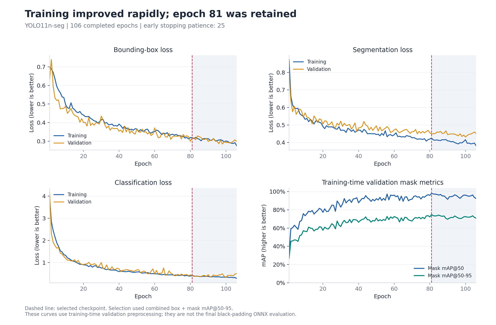
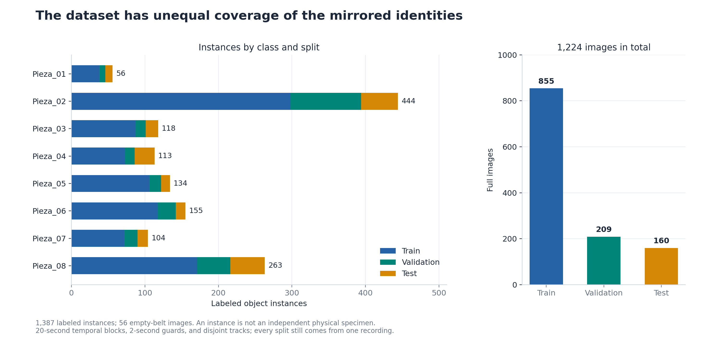
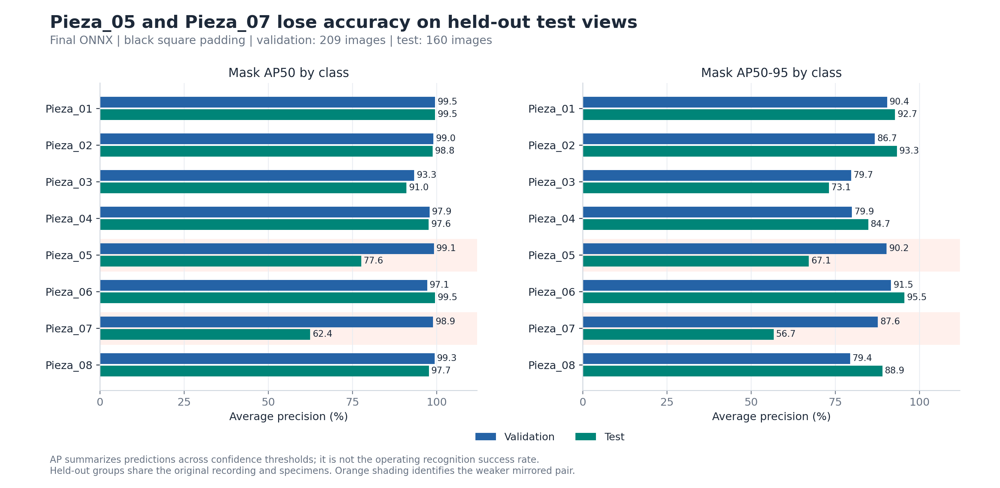
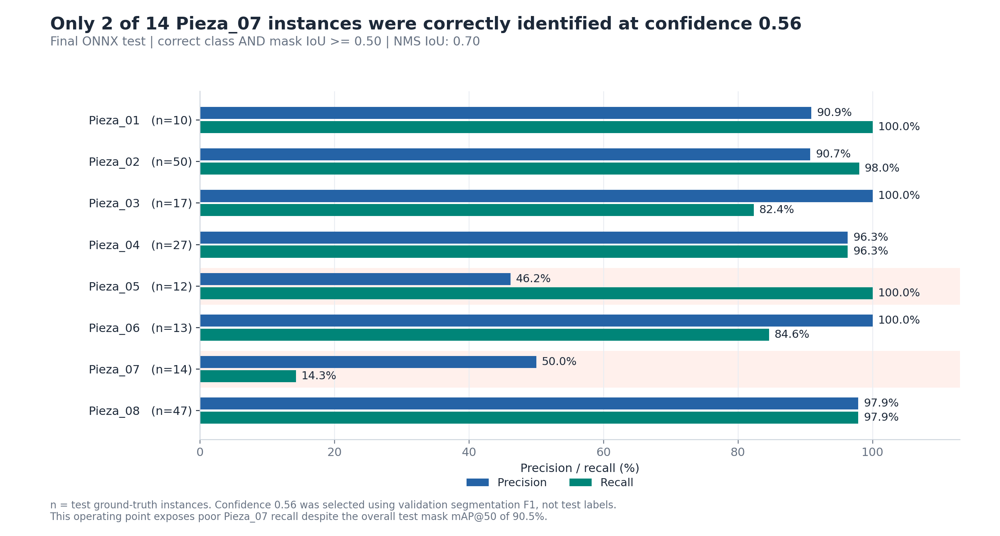
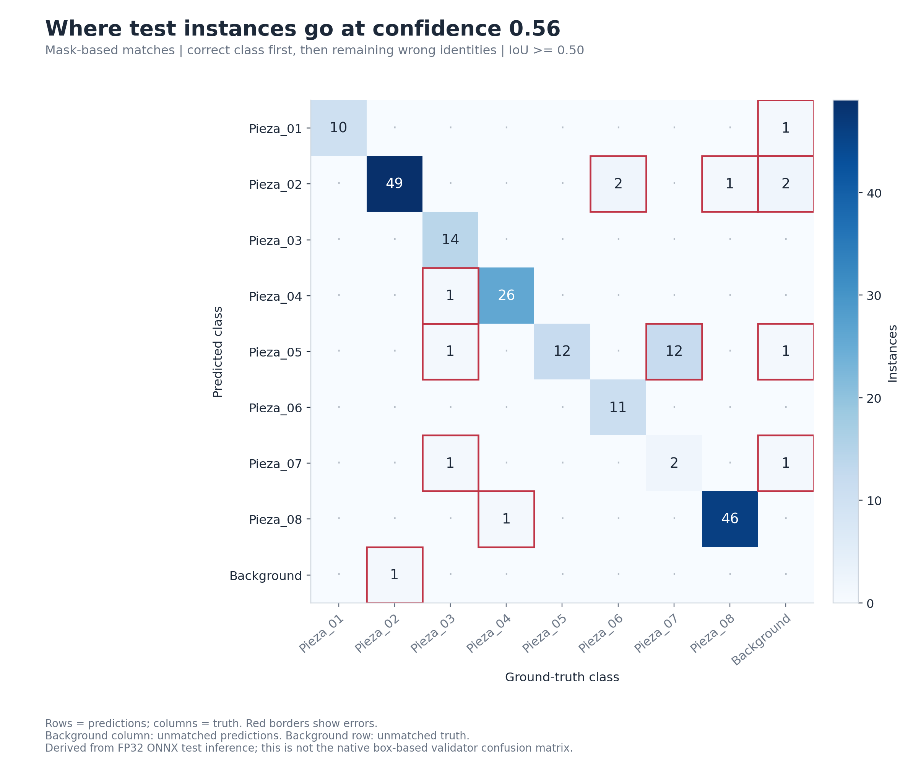
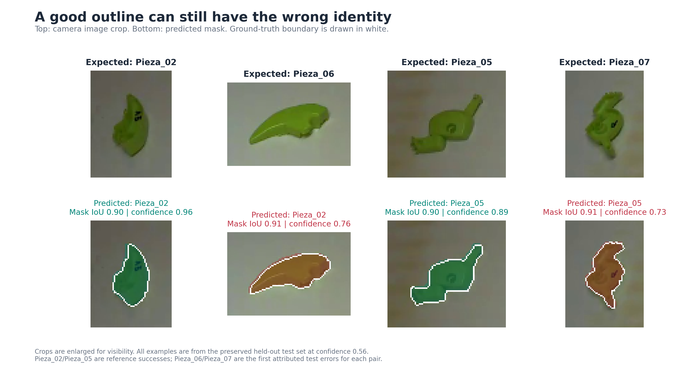
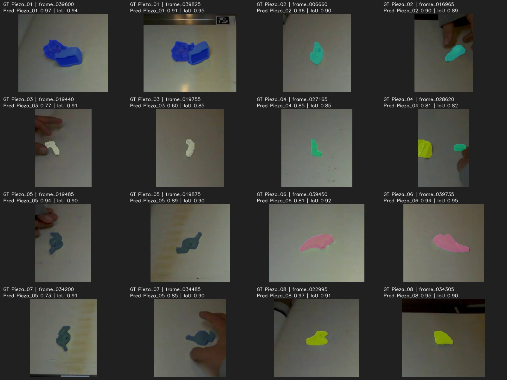

# Training results: figures and tables

Prepared on 2026-10-28 from the preserved YOLO11n-seg experiment. No training, model selection, or camera deployment was performed to make these figures. A CPU inference pass reproduced the original test TP/FP/FN counts before deriving the mask confusion matrix.

**Main result:** the model exports correctly and segments many parts well, but mirrored identities are confused. At confidence 0.56, mask matching attributes 12 of 14 Pieza_07 instances to Pieza_05, and 2 of 13 Pieza_06 instances to Pieza_02. These are FP32 ONNX test results, not measured camera error rates.

## Experiment at a glance

| Item | Result |
|---|---|
| Model / input | YOLO11n-seg / 640 x 640 |
| Completed epochs / selected epoch | 106 / 81 |
| Training / validation / test images | 855 / 209 / 160 |
| Training / validation / test instances | 962 / 235 / 190 |
| Final ONNX test mask mAP@50 | 90.49% |
| Final ONNX test mask mAP@50-95 | 81.50% |
| Reference confidence / mask matching IoU | 0.56 / 0.50 |
| Pieza_07 true positives / ground truth | 2 / 14 at confidence 0.56 |
| Empty-belt test images with false positives | 0 of 7 at confidence 0.56 |

mAP is average precision across classes and confidence levels, not the percentage of physical parts correctly identified in operation. Confidence 0.56 was selected on validation mean segmentation F1 and was not selected using the test results.

## Figures

### Training progress

Training and validation losses plus training-time validation mask metrics. The dashed line marks epoch 81; checkpoint selection combined box and mask mAP@50-95. These training-time curves use different evaluation preprocessing from the final ONNX metrics.

[High-resolution PNG](01_training_history.png) | [Editable vector SVG](01_training_history.svg)

### Dataset coverage

Labeled instances by class and split, and the full-image split. Multiple images from a tracked sequence are correlated; instance counts are not specimen counts.

[High-resolution PNG](02_dataset_balance.png) | [Editable vector SVG](02_dataset_balance.svg)

### Validation versus test AP

The exported model performs much worse on held-out Pieza_05 and Pieza_07 views than on validation views. Both evaluations use the final ONNX and black square padding; this is not a comparison of PyTorch against ONNX.

[High-resolution PNG](03_validation_vs_test.png) | [Editable vector SVG](03_validation_vs_test.svg)

### Identity recognition at the reference threshold

Precision and recall require both the correct class and mask IoU >= 0.50. The labels include test sample counts. Pieza_07 recall is 14.3% at confidence 0.56.

[High-resolution PNG](04_precision_recall.png) | [Editable vector SVG](04_precision_recall.svg)

### Mask-based error attribution

Columns are ground truth and rows are predictions. Correct-class matches are assigned first in descending confidence, exactly as in the original operating-point evaluation. Remaining overlapping masks are then paired by descending IoU to attribute wrong identities. Unmatched predictions go in the background column; unmatched ground truth goes in the background row. This preserves the original per-class TP/FP/FN counts. It differs from the native Ultralytics validator matrix, which uses its own box-based matching settings.

[High-resolution PNG](05_mask_confusion_matrix.png) | [Editable vector SVG](05_mask_confusion_matrix.svg)

### Actual image examples

Original RGB crops above; predicted masks below. Ground-truth boundaries are white. Pieza_02 and Pieza_05 use preserved deterministic reference successes. For Pieza_06 and Pieza_07, the first attributed test error for each mirrored pair is shown without selecting by prediction score or visual quality. Good outline overlap coexists with the wrong identity. These are test frames, not new camera captures.

[High-resolution PNG](06_mirrored_pair_examples.png) | [Editable vector SVG](06_mirrored_pair_examples.svg)

### All eight classes: preserved test preview

Copied unchanged from the original delivery. Deterministic early/late examples include their expected and predicted identities, confidence, and mask overlap.

## Per-class results table

| Part | Test n | Mask AP50 (%) | Mask AP50-95 (%) | Precision (%) | Recall (%) | TP | FP | FN |
|---|---:|---:|---:|---:|---:|---:|---:|---:|
| Pieza_01 | 10 | 99.5 | 92.7 | 90.9 | 100.0 | 10 | 1 | 0 |
| Pieza_02 | 50 | 98.8 | 93.3 | 90.7 | 98.0 | 49 | 5 | 1 |
| Pieza_03 | 17 | 91.0 | 73.1 | 100.0 | 82.4 | 14 | 0 | 3 |
| Pieza_04 | 27 | 97.6 | 84.7 | 96.3 | 96.3 | 26 | 1 | 1 |
| Pieza_05 | 12 | 77.6 | 67.1 | 46.2 | 100.0 | 12 | 14 | 0 |
| Pieza_06 | 13 | 99.5 | 95.5 | 100.0 | 84.6 | 11 | 0 | 2 |
| Pieza_07 | 14 | 62.4 | 56.7 | 50.0 | 14.3 | 2 | 2 | 12 |
| Pieza_08 | 47 | 97.7 | 88.9 | 97.9 | 97.9 | 46 | 1 | 1 |

AP columns span confidence thresholds; the remaining metrics use confidence 0.56 and mask IoU >= 0.50. A wrong identity contributes a false positive to the predicted class and a false negative to the true class. Zero errors in a small sample do not prove zero operational errors.

[Table as PNG](08_per_class_results_table.png) | [Table as SVG](08_per_class_results_table.svg)

## Dataset instances table

| Part | Train | Validation | Test | Total |
|---|---:|---:|---:|---:|
| Pieza_01 | 38 | 8 | 10 | 56 |
| Pieza_02 | 298 | 96 | 50 | 444 |
| Pieza_03 | 87 | 14 | 17 | 118 |
| Pieza_04 | 73 | 13 | 27 | 113 |
| Pieza_05 | 106 | 16 | 12 | 134 |
| Pieza_06 | 117 | 25 | 13 | 155 |
| Pieza_07 | 72 | 18 | 14 | 104 |
| Pieza_08 | 171 | 45 | 47 | 263 |

Full images: train 855, validation 209, test 160. Empty-belt images: 39, 10, and 7. The split uses 20-second blocks with two-second boundary guards and disjoint tracks. All sets still come from one video of the same specimens.

## Reproduction and evidence

Run `python generate_training_figures.py` in the recorded environment. The script reads the preserved pipeline and performs static batch-one ONNX inference on the already prepared black-padded test images. It writes only this summary folder and `../Training_Results.zip`; it does not retrain, reselect weights, or overwrite source reports. It verifies every test TP/FP/FN count against the original report before exporting new diagnostics.

- [Detailed training account](../README_ModelTraining.md).
- [Original dataset audit](../YOLO11n_seg_pipeline/dataset/audit.json).
- [Original epoch CSV](../YOLO11n_seg_pipeline/runs/yolo11n_seg_640/results.csv).
- [Original final ONNX evaluation](../YOLO11n_seg_pipeline/DFRobot_Ready/accuracy_report.json).
- [Original export verification](../YOLO11n_seg_pipeline/DFRobot_Ready/export_verification.json).
- [New diagnostic matrix and image matches](mask_confusion_data.json).
- [Example selection and scores](example_sources.json).
- [Figure provenance](figure_manifest.json).

PNG figures are rendered at 220 dpi; SVG charts preserve editable vector text and shapes (photographs remain embedded raster images). The ZIP contains the figures, tables in this Markdown file, provenance, and generation script. Links to the original pipeline and regeneration require the surrounding project, which is not included in the ZIP.
